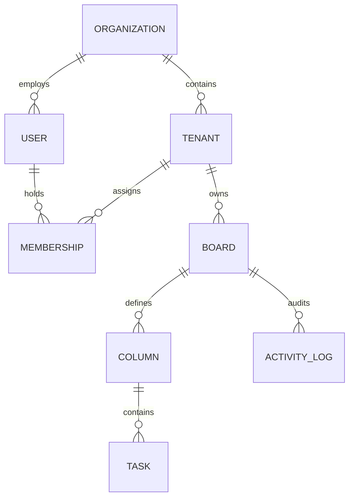

# JulleyOnline — Enterprise Multi-Tenant SaaS Kanban Platform

[](#test-suite-and-verification-evidence)
[](#test-suite-and-verification-evidence)
[](#architecture-overview)
[](#real-time-collaboration--presence)
[](#frontend-architecture)

JulleyOnline is a production-grade, multi-tenant SaaS Kanban project management application built for high-concurrency engineering and operations teams. Designed with strict multi-tenancy isolation, version-based Optimistic Concurrency Control (OCC), integer-based transactional task ordering, real-time Socket.IO collaboration, and a responsive design system replicating enterprise cloud tools.

---

## Table of Contents

1. [Architecture Overview](#architecture-overview)
2. [Multi-Tenancy & Security Boundaries](#multi-tenancy--security-boundaries)
3. [Role-Based Access Control (RBAC) Matrix](#role-based-access-control-rbac-matrix)
4. [Optimistic Concurrency Control (OCC) & Conflict Resolution](#optimistic-concurrency-control-occ--conflict-resolution)
5. [Real-Time Collaboration & Presence Engine](#real-time-collaboration--presence-engine)
6. [Undo / Redo Architecture](#undo--redo-architecture)
7. [Screenshots Gallery](#screenshots-gallery)
8. [Local Development Setup](#local-development-setup)
9. [Pre-Seeded Demo Accounts & Personas](#pre-seeded-demo-accounts--personas)
10. [Test Suite & Verification Evidence](#test-suite-and-verification-evidence)
11. [Key Engineering Trade-offs](#key-engineering-trade-offs)
12. [API & WebSocket Reference](#api--websocket-reference)

---

## Architecture Overview

```
                                      +------------------------------------+
                                      |          React 18 SPA              |
                                      |  (Vite, Tailwind, dnd-kit, Lucide) |
                                      +-----------------+------------------+
                                                        |
                                           HTTP / REST  |  WebSocket (Socket.IO)
                                                        v
                                      +------------------------------------+
                                      |         Node.js Express API        |
                                      |     (Zod Validation, JWT Auth,     |
                                      |    Tenant Scoping, OCC Engine)     |
                                      +-----------------+------------------+
                                                        |
                                                        | Prisma ORM (Pooled)
                                                        v
                                      +------------------------------------+
                                      |         PostgreSQL Database        |
                                      |   (Transactions, Row Locks, OCC)   |
                                      +------------------------------------+
```

### Technology Stack

- **Frontend:** React 18, Vite 6, Tailwind CSS v4, `@dnd-kit/core` & `@dnd-kit/sortable`, `socket.io-client`, Lucide Icons.
- **Backend:** Node.js v20 (ES Modules), Express 4, `socket.io` v4, Zod schema validation, bcryptjs, jsonwebtoken, express-rate-limit.
- **Database & ORM:** PostgreSQL 16 (Port 5433 / 5432), Prisma ORM 5.22.
- **Testing & Verification:** Node.js native test runner (`node --test`), Playwright Browser Automation (`@playwright/test` on Microsoft Edge / Chromium).

---

## Multi-Tenancy & Security Boundaries

JulleyOnline enforces a two-tier multi-tenancy model:



1. **Organization (Top-Level Boundary):**
   - Represents the enterprise entity (e.g. `Acme Technologies`, `Nexus Global Enterprise`).
   - Slugs are globally unique across the system.
   - Has one or more Org Admins with authority over organizational settings and tenant lifecycle.

2. **Tenant Workspace (Data Partition Boundary):**
   - Represents an operational department or division (e.g. `Engineering & Product`, `Marketing & Growth`, `Operations & Fleet`).
   - Slugs are unique per organization.
   - All operational resources—**Boards, Columns, Tasks, and Activity Logs**—are hard-partitioned by `tenantId`.

3. **Tenant-Scoped Authorization Middleware:**
   - Every protected API request requires an `X-Tenant-ID` header alongside the `Authorization: Bearer <token>`.
   - The [`tenantScope`](file:///c:/projects/julleyonline-fde-assignment/backend/src/middlewares/tenantScope.js) middleware validates that the authenticated user holds an active membership in the specified tenant and verifies that the tenant belongs to the authorized organization.

---

## Role-Based Access Control (RBAC) Matrix

JulleyOnline implements granular, context-aware RBAC evaluated at request time against live database memberships:

| Action / Capability | Org Admin | Tenant Admin | Member | Unauthenticated |
| :--- | :---: | :---: | :---: | :---: |
| **Manage Organization Settings** | Yes | No | No | No |
| **Create / Delete Tenant Workspaces** | Yes | No | No | No |
| **Add / Remove Workspace Members** | Yes | Yes | No | No |
| **Assign / Change Workspace Roles** | Yes | Yes | No | No |
| **Create / Update / Delete Boards** | Yes | Yes | No | No |
| **Create / Rename / Reorder Columns** | Yes | Yes | No | No |
| **Delete Empty Column** | Yes | Yes | No | No |
| **Delete Non-Empty Column** | Forbidden | Forbidden | Forbidden | Forbidden |
| **Create / Edit / Move Tasks** | Yes | Yes | Yes | No |
| **Assign Tasks (within tenant)** | Yes | Yes | Yes | No |
| **Delete Tasks** | Yes | Yes | Yes | No |
| **Access Activity History** | Yes | Yes | Yes | No |
| **Real-time Collaboration & Presence**| Yes | Yes | Yes | No |

---

## Optimistic Concurrency Control (OCC) & Conflict Resolution

In high-concurrency collaborative environments, the "last write wins" pattern causes silent data loss. JulleyOnline implements version-based OCC:

### The Concurrency Protocol

1. **Monotonic Versioning:** Every task row in PostgreSQL possesses a monotonically increasing integer `version` field (starts at `1`).
2. **Atomic Verification:** Mutations (`PATCH /tasks/:id`, `POST /tasks/:id/move`, `DELETE /tasks/:id`) require the client to supply the current task `version`.
3. **HTTP 409 Conflict Response:** If another user updated the task in the interim, the database query returns 0 affected rows. The server immediately returns an **HTTP 409 Conflict**:
   ```json
   {
     "success": false,
     "error": {
       "code": "CONFLICT",
       "message": "Task was modified by another collaborator. Please review latest changes.",
       "details": {
         "conflictType": "STALE_VERSION",
         "clientVersion": 1,
         "serverVersion": 2,
         "currentTask": {
           "id": "c1f7a28e-...",
           "title": "Updated Task Title",
           "version": 2
         }
       }
     }
   }
   ```
4. **Interactive Conflict Modal:** The React frontend renders the [`ConflictModal`](file:///c:/projects/julleyonline-fde-assignment/frontend/src/components/modals/ConflictModal.jsx) displaying a visual side-by-side diff (your uncommitted edits vs the server's authoritative version) and offers a one-click **"Accept Server State & Refresh"** button.

### Integer-Based Contiguous Task Ordering

Task positions within a column are strictly contiguous integers `0, 1, 2, ... N-1`. When moving a card:
- The backend executes a PostgreSQL transaction that closes the position gap in the source column (`UPDATE task SET position = position - 1 WHERE column_id = oldCol AND position > oldPos`).
- Opens a gap in the target column (`UPDATE task SET position = position + 1 WHERE column_id = newCol AND position >= newPos`).
- Places the task at `newPos` and increments its `version`.
- Guarantees zero decimal drift, zero collision under concurrent moves, and complete rollback on failure.

---

## Real-Time Collaboration & Presence Engine

Attached directly to the Node.js HTTP server via **Socket.IO** (`backend/src/socket/index.js`):

1. **JWT Handshake Authentication:** Sockets must pass a valid JWT bearer token in `auth: { token }`. Missing or forged tokens are rejected immediately.
2. **Tenant & Board Scoped Rooms:** Socket joins are authorized against live PostgreSQL memberships. Rooms follow the format `tenant:<tenantId>:board:<boardId>`. Cross-tenant join attempts are rejected.
3. **Commit-Before-Emit Pattern:** Real-time events (`task:created`, `task:updated`, `task:moved`, `task:deleted`) are emitted **only after** PostgreSQL transaction commit succeeds.
4. **Presence Tracking with Multi-Tab Handling:**
   - Online presence maps `userId -> Set<socketId>` per board room.
   - Opening multiple browser tabs for the same user increments socket connections but counts as 1 online collaborator.
   - Closing one tab leaves the user online; closing the final tab emits `presence:leave` to collaborators.
5. **Network Reconnection & Recovery:**
   - If the network drops, the frontend automatically re-authenticates and rejoins the board room.
   - Triggers an authoritative snapshot resync (`GET /api/v1/boards/:id`) to catch up on any missed edits.

---

## Undo / Redo Architecture

Implemented in [`frontend/src/context/UndoRedoContext.jsx`](file:///c:/projects/julleyonline-fde-assignment/frontend/src/context/UndoRedoContext.jsx):

- **Command Pattern Stack:** Maintains a bounded history stack (up to 30 actions) of reversible actions: `TASK_MOVE`, `TASK_UPDATE`, `TASK_CREATE`, and `TASK_DELETE`.
- **Keyboard Shortcuts:** `Ctrl+Z` (or `Cmd+Z`) triggers Undo; `Ctrl+Y` (or `Cmd+Shift+Z`) triggers Redo.
- **OCC Safeguards:** Undo/Redo commands query the live task from the canvas and supply its current version to the backend. If another collaborator edited the task while in the undo history, the server rejects stale reverts with HTTP 409 Conflict, preventing accidental overwrites.

---

## Screenshots Gallery

High-fidelity screenshots captured directly from the running application:

| Screen | Description | Screenshot Link |
| :--- | :--- | :---: |
| **Authentication Screen** | Dual-pane login with branding & demo account shortcuts | [Login Screen](docs/phase3_01_login.png) |
| **Kanban Board Workspace** | Active sprint board with Backlog, In Progress, Review, and Done columns | [Live Kanban Board](docs/phase3_03_kanban_board.png) |
| **Searchable Board Selector** | Searchable dropdown with `#<id8>` badges, task counts & "Create Board" | [Board Selector](docs/phase3_02_boards.png) |
| **Task Details Drawer** | Slide-out editor with priority badges, assignment, and OCC version pill | [Task Drawer](docs/phase3_04_task_drawer.png) |
| **Real-Time Collaboration** | Multi-user presence avatar stack, Live status pill & Undo/Redo toolbar | [Live Collaboration](docs/phase4_collab_live.png) |
| **Workspace Members** | Role management table (Org Admin, Tenant Admin, Member) | [Members Page](docs/phase3_05_members.png) |
| **Activity Audit Feed** | Comprehensive audit trail of moves, edits, and assignments | [Activity Logs](docs/phase3_06_activities.png) |
| **Workspace Settings** | Tenant workspace configuration & danger zone | [Settings Page](docs/phase3_07_settings.png) |

---

## Local Development Setup

### Prerequisites

- **Node.js**: v20.x or higher
- **pnpm**: v9.x or higher (`npm install -g pnpm`)
- **PostgreSQL**: PostgreSQL 15+ running locally (default: port 5433 or 5432)

### 1. Repository Setup

```bash
git clone https://github.com/organization/julleyonline-fde-assignment.git
cd julleyonline-fde-assignment
```

### 2. Backend Setup & Database Migration

```bash
cd backend
pnpm install

# Copy configuration template
cp .env.example .env

# Run Prisma database migrations and seed baseline data
npx prisma migrate dev --name init
node prisma/seed.js

# Provision isolated test database
node scripts/setup-test-db.js
```

### 3. Frontend Setup

```bash
cd ../frontend
pnpm install
pnpm run build
```

### 4. Running the Application

In terminal 1 (Backend API & Socket.IO server):
```bash
cd backend
pnpm run dev
# Server running at http://localhost:5000 (Health check: http://localhost:5000/api/health)
```

In terminal 2 (Frontend React SPA):
```bash
cd frontend
pnpm run dev
# Frontend accessible at http://localhost:5173
```

---

## Pre-Seeded Demo Accounts & Personas

Password for all pre-seeded accounts: **`password123`**

| Persona | Email | Organization | Tenant Workspace | Assigned Role | Primary Capabilities |
| :--- | :--- | :--- | :--- | :--- | :--- |
| **Alice Smith** | `alice@acme.com` | Acme Technologies | Engineering & Product | **Org Admin** | Full access to Acme; tenant creation, org settings. |
| **Bob Smith** | `bob@acme.com` | Acme Technologies | Engineering & Product | **Tenant Admin** | Admin in Engineering; Member in Marketing. |
| **Charlie Brown** | `charlie@acme.com` | Acme Technologies | Engineering & Product | **Member** | Task CRUD & movement; cannot create boards or columns. |
| **Diana Prince** | `diana@nexus.com` | Nexus Global | Operations & Fleet | **Org Admin** | Cross-org isolation proof (cannot access any Acme data). |
| **Edward Norton** | `edward@nexus.com` | Nexus Global | Operations & Fleet | **Tenant Admin** | Admin for Nexus Fleet Dispatch board. |

---

## Test Suite and Verification Evidence

JulleyOnline includes **107 fully automated positive, negative, security, and concurrency tests**:

### Running Backend Tests (91 Tests)

```bash
cd backend
pnpm test
```
*Executes against isolated test database `julleyonline_kanban_test` on dedicated port 5001.*

- **Phase 1A: Backend Foundation (8 tests):** Config validation, health check, custom domain error handlers.
- **Phase 1B: Authentication & RBAC (26 tests):** Registration atomicity, bcrypt hashing, JWT tampering, dynamic membership revocation.
- **Phase 2A: Organization & Tenant Management (21 tests):** Workspace CRUD, last Org Admin deletion safety, membership assignment.
- **Phase 2B: Boards, Columns & OCC (27 tests):** Board CRUD, integer task reordering, OCC version incrementing, HTTP 409 conflict contract, transaction rollback on failure.
- **Phase 4: Socket.IO & Collaboration (9 tests):** JWT socket handshake, room isolation, multi-tab presence deduplication, post-commit broadcasts.

### Running Frontend Playwright Tests (16 Tests)

```bash
cd frontend
npx playwright test tests/board-selector.spec.js tests/e2e.spec.js tests/phase4-collab.spec.js
```

- **Board Selector & Search (`board-selector.spec.js` - 6 tests):** Real-time search by name/short ID, multiple boards with identical names, tenant isolation, RBAC controls.
- **End-to-End Real Persistence (`e2e.spec.js` - 4 tests):** Login session hydration, Board/Task CRUD persistence across reloads, non-empty column deletion policy, Member RBAC boundary.
- **Real-Time Collaboration & Concurrency (`phase4-collab.spec.js` - 6 tests):** Multi-user room presence pill, real-time task creation/movement broadcast, HTTP 409 conflict modal reconciliation, Undo/Redo OCC validation, socket reconnection recovery.

---

## Key Engineering Trade-offs

1. **Optimistic Concurrency Control (OCC) vs. CRDT / Operational Transformation (OT):**
   - *Decision:* OCC with atomic version matching and HTTP 409 Conflict protocol.
   - *Rationale:* Kanban task management is card-level transactional, not character-by-character collaborative text editing. OCC guarantees atomic database consistency, avoids complex distributed conflict resolution algorithms, and gives users transparent choice when conflicts occur.

2. **Contiguous Integer Ordering vs. Floating-Point / Lexorank Ordering:**
   - *Decision:* Transactional contiguous integer position shifting (`0, 1, 2, ... N-1`).
   - *Rationale:* Floating-point and fractional string (Lexorank) indexing suffer from precision exhaustion after repeated drops and require complex asynchronous rebalancing jobs. PostgreSQL row-level locks within transactions guarantee strict deterministic order without decimal degradation.

3. **In-Memory Socket.IO Rooms vs. Redis Pub/Sub Cluster:**
   - *Decision:* Process-attached Socket.IO rooms with multi-tab connection maps.
   - *Rationale:* Optimized for single-server zero-dependency local deployment and rapid development without requiring Redis infrastructure. Can be scaled horizontally by plugging in `@socket.io/redis-adapter` without changing application business logic.

---

## API & WebSocket Reference

Comprehensive API specifications are documented in [`docs/api-documentation.md`](docs/api-documentation.md).

### Core Endpoints Quick Reference

| Method | Endpoint | Description | Auth Required |
| :--- | :--- | :--- | :---: |
| `POST` | `/api/v1/auth/register` | Register new organization & initial Org Admin | No |
| `POST` | `/api/v1/auth/login` | Authenticate user; returns JWT & memberships | No |
| `POST` | `/api/v1/auth/switch-context`| Switch active tenant workspace | Bearer JWT |
| `GET` | `/api/v1/boards` | List boards for active tenant | Bearer + Tenant |
| `POST` | `/api/v1/boards` | Create a new board with default columns | Admin only |
| `GET` | `/api/v1/boards/:id` | Authoritative snapshot of board, columns, tasks | Bearer + Tenant |
| `POST` | `/api/v1/columns/:id/tasks` | Create task in column (Zod validated) | Bearer + Tenant |
| `PATCH`| `/api/v1/tasks/:id` | Update task fields (requires `version` for OCC) | Bearer + Tenant |
| `POST` | `/api/v1/tasks/:id/move` | Move task position / column (atomic transaction) | Bearer + Tenant |
| `DELETE`|`/api/v1/columns/:id` | Delete column (rejected if column has tasks) | Admin only |
| `GET` | `/api/v1/boards/:id/activities`| Audit trail of board changes | Bearer + Tenant |

---

## License

JulleyOnline FDE Assignment Project. Designed and developed according to enterprise SaaS engineering specifications.
