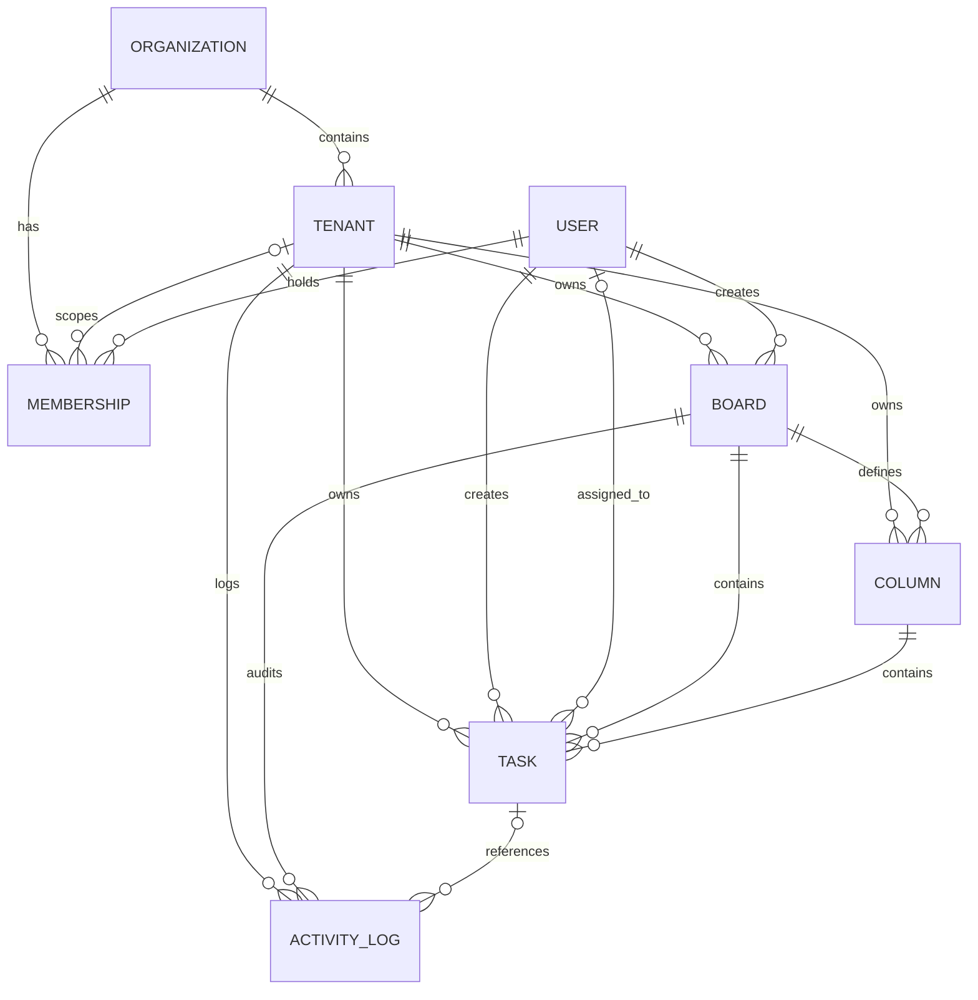

# JulleyOnline — Enterprise Multi-Tenant SaaS Kanban Platform

[](#test-suite-and-verification-evidence)
[](#test-suite-and-verification-evidence)
[](#test-suite-and-verification-evidence)
[](#architecture-overview)
[](#real-time-collaboration--presence)
[](#frontend-architecture)

JulleyOnline is a production-grade, multi-tenant SaaS Kanban project management application built for high-concurrency engineering and operations teams. Designed with strict multi-tenancy isolation, version-based Optimistic Concurrency Control (OCC), integer-based transactional task ordering, real-time Socket.IO collaboration, and a responsive design system replicating enterprise cloud tools.

---

## Assignment Folder Layout (`collaborative-kanban/`)

The repository root is the **`collaborative-kanban/` project folder** in the submission reference layout. It contains `frontend/`, `backend/`, `ai-service/`, `database/`, `docs/`, and `screenshots/`, plus the root configuration and README files. The public GitHub repository has a different name; clone it into the expected local folder using the command below.

- **Database:** [`database/README.md`](database/README.md) explains where to find the authoritative [Prisma schema](backend/prisma/schema.prisma), migration history, and [ER diagram](docs/er-diagram.md). Prisma files remain under `backend/prisma/` so migrations and existing application commands keep working.
- **Screenshots:** [`screenshots/`](screenshots/) contains the captured application screenshots. Existing copies under `docs/` remain to preserve links from detailed documentation and tooling.

---

## 📌 Assignment Deliverables Directory

Evaluators can directly access all key assignment deliverables below:
1. **Source Code & Git Repository:** Fully implemented multi-tenant, high-concurrency Kanban platform.
2. **Database Architecture & ER Diagram:** [`docs/er-diagram.md`](docs/er-diagram.md) — 8-entity Mermaid ER diagram, foreign keys, constraints, and cascade policies.
3. **API & Real-Time WebSocket Documentation:** [`docs/api-documentation.md`](docs/api-documentation.md) — Complete REST endpoints, Zod schemas, OCC error payloads, and Socket.IO events.
4. **Requirement Traceability Matrix (RTM):** [`docs/requirement-traceability-matrix.md`](docs/requirement-traceability-matrix.md) — Comprehensive matrix mapping requirements to source files, tests, and verification evidence.
5. **Comprehensive Test Matrix & Verification Evidence:** [`docs/test-matrix.md`](docs/test-matrix.md) — 193 documented passing automated tests across core backend, frontend browser, and Python AI suites.
6. **Optional AI Kanban Assistant Specification:** [`docs/ai-assistant.md`](docs/ai-assistant.md) — Multi-tenant read-only intelligence extension, 4 allowlisted tools, FastAPI setup, and test evidence.

## Table of Contents

1. [Architecture Overview](#architecture-overview)
2. [Multi-Tenancy & Security Boundaries](#multi-tenancy--security-boundaries)
3. [Role-Based Access Control (RBAC) Matrix](#role-based-access-control-rbac-matrix)
4. [Optimistic Concurrency Control (OCC) & Conflict Resolution](#optimistic-concurrency-control-occ--conflict-resolution)
5. [Real-Time Collaboration & Presence Engine](#real-time-collaboration--presence-engine)
6. [Undo / Redo Architecture](#undo--redo-architecture)
7. [Screenshots Gallery](#screenshots-gallery)
8. [Local Development Setup](#local-development-setup)
9. [Pre-Seeded Demo Accounts & Personas](#pre-seeded-demo-accounts--personas)
10. [Test Suite & Verification Evidence](#test-suite-and-verification-evidence)
11. [Key Engineering Trade-offs](#key-engineering-trade-offs)
12. [API & WebSocket Reference](#api--websocket-reference)
13. [Optional AI Kanban Assistant](#optional-ai-kanban-assistant)

---

## Architecture Overview

```
                                      +------------------------------------+
                                      |          React 18 SPA              |
                                      |  (Vite, Tailwind, dnd-kit, Lucide) |
                                      +-----------------+------------------+
                                                        |
                                           HTTP / REST  |  WebSocket (Socket.IO)
                                                        v
                                      +------------------------------------+
                                      |         Node.js Express API        |
                                      |     (Zod Validation, JWT Auth,     |
                                      |    Tenant Scoping, OCC Engine)     |
                                      +-----------------+------------------+
                                                        |
                                                        | Prisma ORM (Pooled)
                                                        v
                                      +------------------------------------+
                                      |         PostgreSQL Database        |
                                      |   (Transactions, Row Locks, OCC)   |
                                      +------------------------------------+
```

### Technology Stack

- **Frontend:** React 18, Vite 6, Tailwind CSS v3, `@dnd-kit/core` & `@dnd-kit/sortable`, `socket.io-client`, Lucide Icons.
- **Backend:** Node.js v20 (ES Modules), Express 4, `socket.io` v4, Zod schema validation, bcryptjs, jsonwebtoken, express-rate-limit.
- **Database & ORM:** PostgreSQL 16 (Port 5433 / 5432), Prisma ORM 5.22.
- **Testing & Verification:** Node.js native test runner (`node --test`), Playwright Browser Automation (`@playwright/test` on Microsoft Edge / Chromium).

---

## Multi-Tenancy & Security Boundaries

For the complete PostgreSQL entity-relationship specification, constraints, and relational mappings, see [Database ER Diagram & Architecture Specification](docs/er-diagram.md).

JulleyOnline enforces a two-tier multi-tenancy model:



1. **Organization (Top-Level Boundary):**
   - Represents the enterprise entity (e.g. `Acme Technologies`, `Nexus Global Enterprise`).
   - Slugs are globally unique across the system.
   - Has one or more Org Admins with authority over organizational settings and tenant lifecycle.

2. **Tenant Workspace (Data Partition Boundary):**
   - Represents an operational department or division (e.g. `Engineering & Product`, `Marketing & Growth`, `Operations & Fleet`).
   - Slugs are unique per organization.
   - All operational resources—**Boards, Columns, Tasks, and Activity Logs**—are hard-partitioned by `tenantId`.

3. **Tenant-Scoped Authorization Middleware:**
   - Every protected API request requires an `X-Tenant-ID` header alongside the `Authorization: Bearer <token>`.
   - The [`tenant.middleware.js`](backend/src/middlewares/tenant.middleware.js) middleware validates that the authenticated user holds an active membership in the specified tenant and verifies that the tenant belongs to the authorized organization.

---

## Role-Based Access Control (RBAC) Matrix

JulleyOnline implements granular, context-aware RBAC evaluated at request time against live database memberships:

| Action / Capability | Org Admin | Tenant Admin | Member | Unauthenticated |
| :--- | :---: | :---: | :---: | :---: |
| **Manage Organization Settings** | Yes | No | No | No |
| **Create / Delete Tenant Workspaces** | Yes | No | No | No |
| **Add / Remove Workspace Members** | Yes | Yes | No | No |
| **Assign / Change Workspace Roles** | Yes | Yes | No | No |
| **Create / Update / Delete Boards** | Yes | Yes | No | No |
| **Create / Rename / Reorder Columns** | Yes | Yes | No | No |
| **Delete Empty Column** | Yes | Yes | No | No |
| **Delete Non-Empty Column** | Forbidden | Forbidden | Forbidden | Forbidden |
| **Create / Edit / Move Tasks** | Yes | Yes | Yes | No |
| **Assign Tasks (within tenant)** | Yes | Yes | Yes | No |
| **Delete Tasks** | Yes | Yes | Yes | No |
| **Access Activity History** | Yes | Yes | Yes | No |
| **Real-time Collaboration & Presence**| Yes | Yes | Yes | No |


### Database Integrity, Indexing & Scoping Invariants

1. **Identifier & Timestamp Generation:** Primary key UUIDs (`@default(uuid())`) and mutation timestamps (`@updatedAt`) are generated and managed by Prisma ORM at the application layer to maintain database portability across PostgreSQL instances without requiring custom server-side functions.
2. **Tenant Scoping Architecture:** Foreign keys enforce strict referential integrity across all eight relational tables. Logical tenant boundaries are enforced at the backend through mandatory `tenant.middleware.js` token and membership verification, combined with explicit `where: { tenantId }` constraints on every operational query.
3. **Organization Membership Uniqueness (`idx_unique_org_admin_membership`):** Standard PostgreSQL `UNIQUE (user_id, org_id, tenant_id)` treats `NULL` as distinct per the SQL standard. To prevent duplicate organization-level administrative roles when `tenant_id` is `NULL`, migration `20261031175300_org_membership_unique` enforces a partial unique index:
   ```sql
   CREATE UNIQUE INDEX "idx_unique_org_admin_membership" 
   ON "memberships"("user_id", "org_id") 
   WHERE "tenant_id" IS NULL;
   ```
4. **Activity Logs Lifecycle:** Activity logs provide an audit trail of task moves, edits, and assignments. In accordance with database cascading rules, deleting an organization, tenant workspace, or user cascades to delete their associated activity logs, and deleting a task sets `task_id` to `NULL` (`ON DELETE SET NULL`).
5. **Transactional Contiguous Ordering:** Task positions (`0, 1, ... N-1`) within columns are maintained contiguously inside PostgreSQL transactions serialized under column row locks (`SELECT 1 FROM columns WHERE id = ... FOR UPDATE`). This application-level serialization prevents decimal indexing drift while allowing flexible reordering without database-level unique index lock deadlocks.

### Organization & Workspace Deletion Permissions & Forced Deletion Policy

JulleyOnline enforces strict tenant hierarchy integrity and prevents accidental data loss through its **Safe Deletion Policy**:
- **Role Requirement:** Only an **Org Admin** has permission to delete an Organization or Tenant Workspace. Tenant Admins and Members are denied with `HTTP 403 Forbidden`.
- **Dependency Guard & Warning:** If an Organization has active workspaces or boards, or if a Tenant Workspace has boards or tasks, a standard `DELETE` request is rejected with `HTTP 400 Bad Request`. The API response contains a detailed warning and an inventory of dependent entities.
- **Forced Deletion (`?force=true`):** To permanently destroy an Organization or Tenant and all subordinate boards, columns, tasks, activities, and memberships, the Org Admin must supply the explicit query flag `?force=true`.
- **Tenant Membership Permissions & Cross-Organization Boundaries:** Users belong to an Organization and hold contextual memberships within specific Tenant Workspaces. Users can possess different roles across workspaces (e.g. Bob is Tenant Admin in Engineering, but Member in Marketing). Cross-organization collaboration is strictly prohibited: users cannot access data, switch context, or receive WebSocket broadcasts outside their assigned organization (`HTTP 403 Forbidden`).

---

## Optimistic Concurrency Control (OCC) & Conflict Resolution

In high-concurrency collaborative environments, the "last write wins" pattern causes silent data loss. JulleyOnline implements version-based OCC:

### The Concurrency Protocol

1. **Monotonic Versioning:** Every task row in PostgreSQL possesses a monotonically increasing integer `version` field (starts at `1`).
2. **Atomic Verification:** Mutations (`PUT /api/v1/tasks/:id`, `POST /api/v1/tasks/:id/move`, `DELETE /api/v1/tasks/:id?version=<n>`) require the client to supply the current task `version`.
3. **HTTP 409 Conflict Response:** If another user updated the task in the interim, the database query returns 0 affected rows. The server immediately returns an **HTTP 409 Conflict**:
   ```json
   {
     "success": false,
     "error": {
       "code": "CONFLICT",
       "message": "Task was modified by another collaborator. Please review latest changes.",
       "details": {
         "conflictType": "STALE_VERSION",
         "clientVersion": 1,
         "serverVersion": 2,
         "currentTask": {
           "id": "c1f7a28e-...",
           "title": "Updated Task Title",
           "version": 2
         }
       }
     }
   }
   ```
4. **Interactive Conflict Modal:** The React frontend renders the [`ConflictModal`](frontend/src/components/modals/ConflictModal.jsx) displaying a visual side-by-side diff (your uncommitted edits vs the server's authoritative version) and offers a one-click **"Accept Server State & Refresh"** button.

### Integer-Based Contiguous Task Ordering

Task positions within a column are strictly contiguous integers `0, 1, 2, ... N-1`. When moving a card:
- The backend executes a PostgreSQL transaction that closes the position gap in the source column (`UPDATE task SET position = position - 1 WHERE column_id = oldCol AND position > oldPos`).
- Opens a gap in the target column (`UPDATE task SET position = position + 1 WHERE column_id = newCol AND position >= newPos`).
- Places the task at `newPos` and increments its `version`.
- Guarantees zero decimal drift, zero collision under concurrent moves, and complete rollback on failure.

---

## Real-Time Collaboration & Presence Engine

Attached directly to the Node.js HTTP server via **Socket.IO** (`backend/src/socket/index.js`):

1. **JWT Handshake Authentication:** Sockets must pass a valid JWT bearer token in `auth: { token }`. Missing or forged tokens are rejected immediately.
2. **Tenant & Board Scoped Rooms:** Socket joins are authorized against live PostgreSQL memberships. Rooms follow the format `tenant:<tenantId>:board:<boardId>`. Cross-tenant join attempts are rejected.
3. **Commit-Before-Emit Pattern:** Real-time events (`task:created`, `task:updated`, `task:moved`, `task:deleted`) are emitted **only after** PostgreSQL transaction commit succeeds.
4. **Presence Tracking with Multi-Tab Handling:**
   - Online presence maps `userId -> Set<socketId>` per board room.
   - Opening multiple browser tabs for the same user increments socket connections but counts as 1 online collaborator.
   - Closing one tab leaves the user online; closing the final tab broadcasts updated presence to collaborators through `presence:sync` and `tenant:presence:sync`.
5. **Network Reconnection & Recovery:**
   - If the network drops, the frontend automatically re-authenticates and rejoins the board room.
   - Triggers an authoritative snapshot resync (`GET /api/v1/boards/:id`) to catch up on any missed edits.

---

## Undo / Redo Architecture

Implemented in [`frontend/src/context/UndoRedoContext.jsx`](frontend/src/context/UndoRedoContext.jsx):

- **Command Pattern Stack:** Maintains a bounded history stack (up to 30 actions) of reversible actions: `TASK_MOVE`, `TASK_UPDATE`, `TASK_CREATE`, and `TASK_DELETE`.
- **Keyboard Shortcuts:** `Ctrl+Z` (or `Cmd+Z`) triggers Undo; `Ctrl+Y` (or `Cmd+Shift+Z`) triggers Redo.
- **OCC Safeguards:** Undo/Redo commands query the live task from the canvas and supply its current version to the backend. If another collaborator edited the task while in the undo history, the server rejects stale reverts with HTTP 409 Conflict, preventing accidental overwrites.

---

## Screenshots Gallery

High-fidelity screenshots captured directly from the running application:

| Screen | Description | Screenshot Link |
| :--- | :--- | :---: |
| **Authentication Screen** | Dual-pane login with branding & demo account shortcuts | [Login Screen](screenshots/phase3_01_login.png) |
| **Kanban Board Workspace** | Active sprint board with Backlog, In Progress, Review, and Done columns | [Live Kanban Board](screenshots/phase3_03_kanban_board.png) |
| **Searchable Board Selector** | Searchable dropdown with `#<id8>` badges, task counts & "Create Board" | [Board Selector](screenshots/phase3_02_boards.png) |
| **Task Details Drawer** | Slide-out editor with priority badges, assignment, and OCC version pill | [Task Drawer](screenshots/phase3_04_task_drawer.png) |
| **Real-Time Collaboration** | Multi-user presence avatar stack, Live status pill & Undo/Redo toolbar | [Live Collaboration](screenshots/phase4_collab_live.png) |
| **Workspace Members** | Role management table (Org Admin, Tenant Admin, Member) | [Members Page](screenshots/phase3_05_members.png) |
| **Activity Audit Feed** | Comprehensive audit trail of moves, edits, and assignments | [Activity Logs](screenshots/phase3_06_activities.png) |
| **Workspace Settings** | Tenant workspace configuration & danger zone | [Settings Page](screenshots/phase3_07_settings.png) |

---

## Local Development Setup

### Prerequisites

- **Node.js**: v20.x or higher
- **pnpm**: v9.x or higher (`npm install -g pnpm`)
- **PostgreSQL**: PostgreSQL 15+ running locally (default: port 5433 or 5432)

### 1. Repository Setup

```bash
git clone https://github.com/Nikhil166-tech/julleyonline-fde-assignment..git collaborative-kanban
cd collaborative-kanban
```

### 2. Backend Setup & Database Migration

```bash
cd backend
pnpm install

# Copy configuration templates
cp .env.example .env
cp .env.test.example .env.test

# Run Prisma database migrations and seed baseline development data
npx prisma migrate deploy
pnpm run prisma:seed

# Provision and seed isolated test database
node scripts/setup-test-db.js
```

### 3. Frontend Setup

```bash
cd ../frontend
pnpm install
pnpm run build
```

### 4. Running the Application

In terminal 1 (Backend API & Socket.IO server):
```bash
cd backend
pnpm run dev
# Server running at http://localhost:5000 (Health check: http://localhost:5000/api/health)
```

In terminal 2 (Frontend React SPA):
```bash
cd frontend
pnpm run dev
# Frontend accessible at http://localhost:5173
```

---

## Pre-Seeded Demo Accounts & Personas

Password for all pre-seeded accounts: **`password123`**

| Persona | Email | Organization | Tenant Workspace | Assigned Role | Primary Capabilities |
| :--- | :--- | :--- | :--- | :--- | :--- |
| **Alice Smith** | `alice@acme.com` | Acme Technologies | Engineering & Product | **Org Admin** | Full access to Acme; tenant creation, org settings, safe deletion. |
| **Bob Smith** | `bob@acme.com` | Acme Technologies | Engineering & Product | **Tenant Admin** | Admin in Engineering; Member in Marketing. |
| **Charlie Brown** | `charlie@acme.com` | Acme Technologies | Engineering & Product | **Member** | Task CRUD & movement; cannot create boards or columns. |
| **Diana Prince** | `diana@nexus.com` | Nexus Global | Operations & Fleet | **Org Admin** | Cross-org isolation proof (cannot access any Acme data). |
| **Edward Norton** | `edward@nexus.com` | Nexus Global | Operations & Fleet | **Tenant Admin** | Admin for Nexus Fleet Dispatch board. |

---

## Test Suite and Verification Evidence

JulleyOnline includes **140 fully automated positive, negative, security, and concurrency tests**:

### Running Backend Tests (117 Tests)

```bash
cd backend
pnpm test
```
*Executes against isolated test database `julleyonline_kanban_test` on dedicated port 5001.*

- **Phase 1A: Backend Foundation (9 tests):** Config validation, test DB safety guard (`TC-SAF-01` in `testDbGuard.js`), health check, custom domain error handlers.
- **Phase 1B: Authentication & RBAC (29 tests):** Registration atomicity, auto slug generation, empty slug tolerance, non-alphanumeric rejection, bcrypt hashing, JWT tampering, dynamic membership revocation, Org Admin effectiveRole preservation.
- **Phase 2A: Organization & Tenant Management (28 tests):** Workspace CRUD, safe deletion policy with dependency checks, context switching, tenant-wide activity audit, serialized concurrent Org Admin protection (2-admin and 3-admin overlapping races).
- **Phase 2B: Boards, Columns & OCC (40 tests):** Board CRUD, column locking, contiguous integer task reordering, OCC version incrementing, versioned task deletion OCC, edit/delete race resolution, move/delete race resolution, double-deletion race handling, HTTP 409 conflict contract, concurrent creation serialization, concurrent column creation serialization, column deletion locking, true column deletion vs task creation concurrency (Scenarios A & B).
- **Phase 4: Socket.IO & Collaboration (11 tests):** JWT socket handshake, room isolation, multi-tab presence deduplication, post-commit broadcasts, immediate WebSocket revocation, tenant room switching.

### Running Frontend Playwright Tests (23 Tests)

```bash
cd frontend
npx playwright test tests/board-selector.spec.js tests/e2e.spec.js tests/phase4-collab.spec.js
```

- **Board Selector & Search (`board-selector.spec.js` - 7 tests):** Real-time search by name/short ID, multiple boards with identical names, tenant isolation, RBAC controls, and tenant-switching race condition prevention (`SEL-07`).
- **End-to-End Real Persistence (`e2e.spec.js` - 7 tests):** Login session hydration, Board/Task CRUD persistence across reloads, non-empty column deletion policy, Member RBAC boundary, Admin deletion controls, React browser form registration bootstrap, and versioned task deletion OCC.
- **Real-Time Collaboration & Concurrency (`phase4-collab.spec.js` - 9 tests):** Multi-user room presence pill, real-time task creation/movement broadcast, HTTP 409 conflict modal reconciliation, Undo/Redo OCC validation, socket reconnection recovery, multi-collaborator undo rejection, synchronous task version tracking & optimistic mutation snapshot protection (`COL-09`), multi-tab presence deduplication and tenant switching active user scoping (`COL-10`).

---

## Key Engineering Trade-offs

1. **Optimistic Concurrency Control (OCC) vs. CRDT / Operational Transformation (OT):**
   - *Decision:* OCC with atomic version matching and HTTP 409 Conflict protocol.
   - *Rationale:* Kanban task management is card-level transactional, not character-by-character collaborative text editing. OCC guarantees atomic database consistency, avoids complex distributed conflict resolution algorithms, and gives users transparent choice when conflicts occur.

2. **Contiguous Integer Ordering vs. Floating-Point / Lexorank Ordering:**
   - *Decision:* Transactional contiguous integer position shifting (`0, 1, 2, ... N-1`) serialized under PostgreSQL row locks.
   - *Rationale:* Floating-point and fractional string (Lexorank) indexing suffer from precision exhaustion after repeated drops and require complex asynchronous rebalancing jobs. PostgreSQL column-level row locks within transactions guarantee strict deterministic order without decimal degradation.

3. **In-Memory Socket.IO Rooms vs. Redis Pub/Sub Cluster:**
   - *Decision:* Process-attached Socket.IO rooms with multi-tab connection maps and supported `socket.data` identity storage.
   - *Rationale:* Optimized for single-server zero-dependency local deployment and rapid development without requiring Redis infrastructure. Can be scaled horizontally by plugging in `@socket.io/redis-adapter` without changing application business logic.

---

## API & WebSocket Reference

Comprehensive API specifications are documented in [`docs/api-documentation.md`](docs/api-documentation.md).

### Core Endpoints Quick Reference

| Method | Endpoint | Description | Auth Required |
| :--- | :--- | :--- | :---: |
| `POST` | `/api/v1/auth/register` | Register new organization & initial Org Admin | No |
| `POST` | `/api/v1/auth/login` | Authenticate user; returns JWT & memberships | No |
| `POST` | `/api/v1/auth/logout` | Logout user (documents stateless client token discard) | Bearer JWT |
| `POST` | `/api/v1/auth/switch-context`| Switch active tenant workspace | Bearer JWT |
| `POST` | `/api/v1/organizations` | Create a new organization with default workspace | Bearer JWT |
| `DELETE`| `/api/v1/organizations/:id` | Delete organization (requires `?force=true` if active) | Org Admin |
| `GET`  | `/api/v1/organizations/:id/tenants` | List all tenant workspaces in organization | Bearer JWT |
| `DELETE`| `/api/v1/organizations/:id/members/:membershipId` | Remove Org Admin/member (protects last Org Admin) | Org Admin |
| `POST` | `/api/v1/organizations/:id/tenants` | Create tenant workspace | Org Admin |
| `DELETE`| `/api/v1/tenants/:id` | Delete tenant workspace (requires `?force=true` if active) | Org Admin |
| `GET` | `/api/v1/tenants/:id/activities` | Tenant workspace-wide activity audit trail | Bearer + Tenant |
| `GET` | `/api/v1/boards` | List boards for active tenant (supports `?q=` search) | Bearer + Tenant |
| `POST` | `/api/v1/boards` | Create a new board with default columns | Admin only |
| `GET` | `/api/v1/boards/:id` | Authoritative snapshot of board, columns, tasks | Bearer + Tenant |
| `POST` | `/api/v1/boards/:boardId/columns` | Create column with contiguous position | Admin only |
| `PUT`  | `/api/v1/columns/:id` | Rename column | Admin only |
| `POST` | `/api/v1/columns/:id/move` | Reorder column position | Admin only |
| `DELETE`|`/api/v1/columns/:id` | Delete column (rejected if column has tasks) | Admin only |
| `GET`  | `/api/v1/tasks` | Search or list tasks in active tenant workspace | Bearer + Tenant |
| `POST` | `/api/v1/boards/:boardId/tasks` | Create task in column (serialized under column lock) | Bearer + Tenant |
| `GET`  | `/api/v1/tasks/:id` | View task details | Bearer + Tenant |
| `PUT`  | `/api/v1/tasks/:id` | Update task fields (requires `version` for OCC) | Bearer + Tenant |
| `DELETE`| `/api/v1/tasks/:id` | Delete task with OCC version check (requires `?version=`) | Creator/Admin |
| `POST` | `/api/v1/tasks/:id/move` | Move task position / column (atomic transaction) | Bearer + Tenant |
| `GET` | `/api/v1/boards/:id/activities`| Audit trail of board changes | Bearer + Tenant |
| `POST` | `/api/v1/ai/chat` | Query read-only AI Kanban Assistant (natural language) | Bearer + Tenant |

---

## Optional AI Kanban Assistant

JulleyOnline includes an **optional, read-only AI Kanban Assistant** extension (documented in detail in [`docs/ai-assistant.md`](docs/ai-assistant.md)).

### Key Architectural Highlights
- **Three-Tier Cascade Pipeline:**
  1. *Tier 1 (Google Gemini):* Fast primary intelligence (`gemini-3.5-flash` / `gemini-3.8-flash`) with 3.5s fast-fail timeout.
  2. *Tier 2 (Ollama Cloud):* Secondary cloud LLM (`gemma4:31b` via `https://ollama.com/api/chat`) with 4.5s fast-fail timeout for seamless failover during rate limits or service outages.
  3. *Tier 3 (Local Deterministic Engine):* In-memory rule synthesizer executing without external network calls when offline or if all LLMs fail.
- **Accurate Aggregations Beyond 100 Tasks:** PostgreSQL database-level aggregations (`prisma.task.count` and `groupBy`) compute exact workspace metrics across all matching tasks while keeping the LLM prompt payload bounded to 100 recent tasks and 30 audit activities.
- **Strict Gateway & Zero Direct DB Access:** The Python microservice has no database credentials or direct database access. The Node.js Express backend serves as the sole gateway, enforcing authentication, tenant membership checks, and context sanitization.
- **Constant-Time Token Auth & Loopback Hardening:** Microservice binds to `127.0.0.1:8000` by default, compares service tokens with `hmac.compare_digest` to eliminate timing side channels, and enforces strong non-default secrets in production.
- **Data Minimization:** Sensitive credentials, passwords, and emails are stripped before data reaches the AI service.
- **4 Allowlisted Read-Only Tools:** `get_tasks`, `get_overdue_tasks`, `get_activity_logs`, and `get_board_summary`.
- **Tenant-Switching Race Protection:** Changing workspaces in the UI immediately aborts in-flight AI requests via `AbortController`, increments request sequencing counters, and resets chat history.
- **Typed Enterprise Widgets & Intent Guardrails:** Answers are categorized into explicit response types (`overdue_summary`, `board_summary`, `task_list`, `activity_summary`, `scope_notice`, `security_notice`) with clean Markdown rendering and expandable tool disclosures.

### Quick Start for AI Service

```bash
cd ai-service
py -m venv venv
.\venv\Scripts\activate
pip install -r requirements.txt
uvicorn main:app --host 127.0.0.1 --port 8000 --reload
```

---

## License

JulleyOnline FDE Assignment Project. Designed and developed according to enterprise SaaS engineering specifications.
