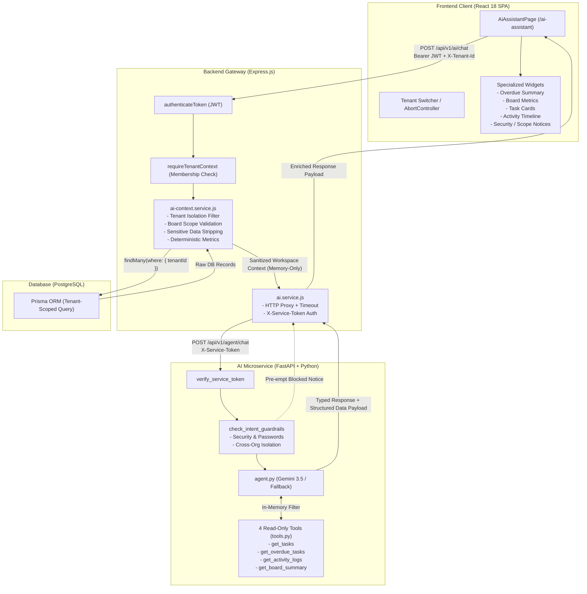
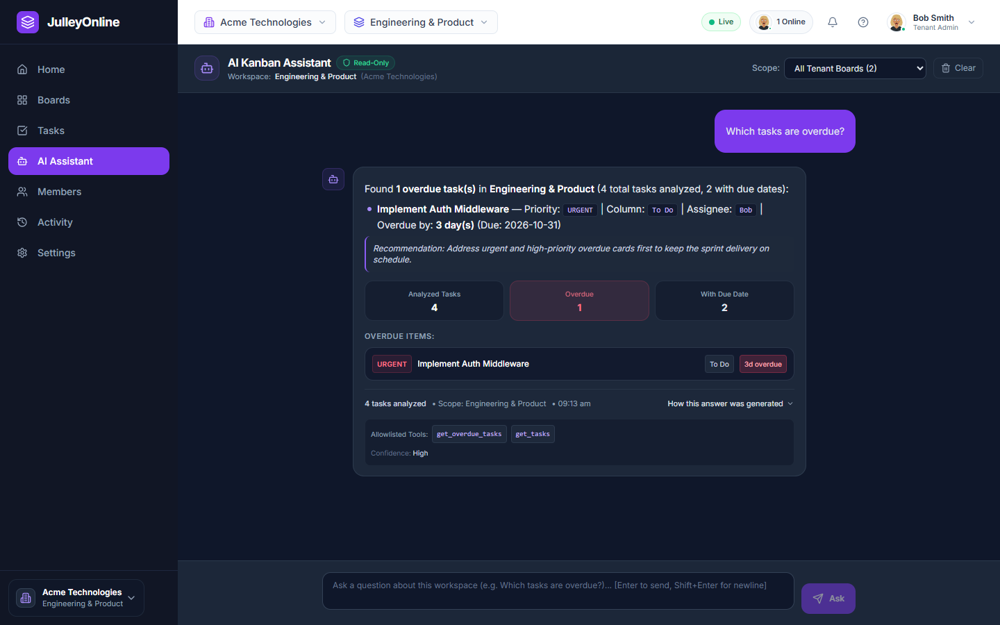
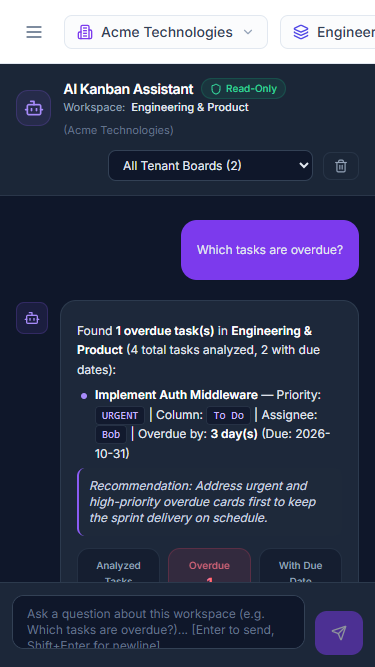

# JulleyOnline — Optional AI Kanban Assistant Specification & Architecture

This document provides the complete architecture, security model, response type classification, REST API specification, Python microservice implementation details, and verification evidence for the **Refined AI Kanban Assistant** in JulleyOnline.

---

## 1. Executive Summary & Purpose

The **AI Kanban Assistant** is an additive, optional, read-only intelligence extension designed to assist multi-tenant engineering and product teams. It answers natural-language workspace questions grounded strictly in authorized, real-time Kanban data, rendered via enterprise-grade UI components rather than raw plain text.

### Key Refinements Applied:
1. **LLM-First Architecture with Automatic Local Fallback:** Google Gemini is the primary generative engine (`gemini-2.5-flash`, with support for `gemini-3.5-flash` / `gemini-3.8-flash`), backed by a bounded retry policy. When the external provider encounters rate limits (HTTP 429), transient outages (HTTP 503), timeouts, or network errors, the assistant seamlessly falls back to its deterministic Python engine without user downtime.
2. **Three Configurable Response Modes (`AI_RESPONSE_MODE`):**
   - `auto` (default): Attempts Gemini first; automatically invokes the deterministic local response engine when Gemini fails or returns unusable output.
   - `local`: Executes the deterministic Python response engine directly without external network requests.
   - `llm`: Invokes Gemini only, returning HTTP 502 Bad Gateway if the provider fails.
3. **Transparent Generation Metadata Contract:** Every response includes authoritative provenance: `{ source: "llm" | "local" | "guardrail", model: string | null, fallbackUsed: boolean, failureReason?: string }`.
4. **Subtle Enterprise UX on Fallback:** When a fallback occurs, the UI displays a clean informational indicator (*"Answered using local workspace analysis."*) and reflects the source in the disclosure without alarming users with raw technical error codes.
5. **Explicit, Validated Response Types:** System classifies answers into typed categories (`overdue_summary`, `board_summary`, `task_list`, `activity_summary`, `scope_notice`, `security_notice`, `general_answer`) to render tailored interactive widgets.
6. **Intent Gating Guardrails:** Dedicated pre-execution security layer protects credentials and cross-organization boundaries before calling tools or LLM APIs.
7. **Safe Markdown Rendering:** Clean typography with zero raw markdown syntax leaks (`**bold**` parsed into semantic bold, styled bullet points, and code badges).
8. **Tool Details Clutter Reduction:** Replaced raw tool name dumps with a clean summary footer (records analyzed, data scope, timestamp) and a subtle expandable *"How this answer was generated"* disclosure showing Generation Source and Allowlisted Tools.

---

## 2. Architecture & Trust Boundaries

The system follows a strict gateway architecture where the Python AI microservice has **zero direct database access**. The existing Express application acts as the single source of truth, enforcing authentication, RBAC, tenant isolation, and data sanitization.



---

## 3. Strict Security & Multi-Tenancy Isolation

### Zero Database Access for Python
- The Python service does **not** have database connection strings, credentials, or Prisma client access.
- It operates strictly as a stateless, in-memory function processing the sanitized JSON context forwarded by Express.

### Intent Gating & Guardrails (Independent of LLM)
- **Credential Protection (`security_notice`):** Inquiries attempting to discover user passwords, password hashes, secrets, or API keys are immediately intercepted. The system returns an educational security notice without querying tools or invoking external LLMs.
- **Cross-Organization Protection (`scope_notice`):** Inquiries requesting projects, boards, or data from other organizations are rejected with an explicit notice explaining the active workspace boundary and directing the user to the top navigation workspace switcher.

### Data Minimization & Privacy Protection
Before sending data to the AI service, Express strips all sensitive fields:
- User email addresses, passwords, password hashes, and external tokens are removed.
- Only display names (`user.name`), task titles, descriptions, priorities, column statuses, and audit timestamps are forwarded.

### Tenant-Switching Race-Condition Protections
- When a user changes workspaces in the UI:
  1. Any in-flight HTTP request to `/api/v1/ai/chat` is immediately aborted via `AbortController.abort()`.
  2. The local `requestIdRef` counter increments, discarding any late-arriving responses from previous tenants.
  3. The chat history, selected board state, and input state are immediately cleared.

---

## 4. Allowlisted Read-Only Tools

The Python microservice exposes 4 strictly read-only tools defined in `ai-service/tools.py`:

| Tool Name | Parameters | Purpose | Return Value |
|---|---|---|---|
| `get_tasks` | `board_id?: str`, `column_id?: str`, `priority?: str`, `assignee_id?: str` | Filters tasks in the active workspace | Array of matching sanitized task objects |
| `get_overdue_tasks` | `board_id?: str` | Computes incomplete tasks past their due date relative to UTC | Overdue task objects, total analyzed, with/without due date counts |
| `get_activity_logs` | `limit: int = 10`, `action?: str`, `entity_type?: str` | Retrieves recent audit log entries in chronological order | Formatted list of workspace activity events |
| `get_board_summary` | `board_id?: str` | Generates aggregate counts, column distributions, and completion % | Summary dictionary with task totals and stage breakdowns |

---

## 5. Explicit Response Types & Presentation Widgets

Rather than returning unstructured blobs of plain text, the assistant returns typed responses:

| `responseType` | UI Presentation Component | Key Data Payload |
|---|---|---|
| `overdue_summary` | 3-card metric bar (Analyzed, Overdue, With Due Date) + overdue task card list with days past due tags. If 0 tasks have due dates, renders an informative alert. | `tasksAnalyzed`, `overdueCount`, `tasksWithDueDates`, `tasksWithoutDueDates`, `tasks` |
| `board_summary` | 4-stat metric row (Total, Pending, Completed %, Overdue) + column breakdown tags + priority pills. | `total_tasks`, `pending_tasks`, `completed_tasks`, `completion_percentage`, `by_column`, `by_priority` |
| `task_list` | Filtered list of task cards with priority badges, column tags, assignee, and due dates. | `totalTasks`, `tasks`, `filterType` |
| `activity_summary` | Chronological activity cards with actor avatar, action description, and timestamp. | `returnedRecords`, `activities` |
| `scope_notice` | Boundary card explaining active tenant workspace and switcher navigation. | `noticeType`, `activeWorkspace`, `reason` |
| `security_notice` | Protected credential card explaining encrypted authentication boundary. | `noticeType`, `status`, `reason` |
| `general_answer` | Clean formatted markdown response with executive summary. | Context metrics |

---

## 6. Screenshots & Visual Interface

### Desktop Experience (`docs/ai_assistant_desktop.png`)


### Mobile Responsive Experience (`docs/ai_assistant_mobile.png`)


---

## 7. Python Microservice (`ai-service/`) Configuration

```bash
cd ai-service

# Create and activate virtual environment
py -m venv venv
.\venv\Scripts\activate   # Windows
# source venv/bin/activate # Linux/macOS

# Install dependencies
pip install -r requirements.txt

# Start microservice with Uvicorn
uvicorn main:app --host 127.0.0.1 --port 8000 --reload
```

### Environment Variables (`ai-service/.env`)
- `AI_RESPONSE_MODE`: Operating mode (`auto` [default], `local`, or `llm`).
- `MOCK_LLM`: Backward-compatible override. When `true`, forces `local` mode.
- `GEMINI_API_KEY`: Google Gemini API key.
- `AI_MODEL`: Primary Gemini model (`gemini-2.5-flash` or `gemini-3.5-flash`).
- `FALLBACK_MODEL`: Secondary Gemini model (`gemini-3.8-flash`).
- `AI_SERVICE_TOKEN`: Shared secret token for Express gateway (`dev-ai-service-token-secret`).

---

## 8. Automated Verification Evidence

The LLM-first AI assistant with automatic fallback is verified across unit, security, integration, and browser automation test suites:

### 1. Python Unit, Security & Scenario Suite (`ai-service/tests/`)
- **29 passed, 0 failed (100% pass rate)**
- `test_agent.py` (22 tests):
  - **Case A (`test_case_a_no_due_dates`):** 11 tasks across 2 boards with no due dates -> returns 0 overdue, 11 analyzed, 0 with due dates, clear explanation.
  - **Case B (`test_case_b_other_organizations`):** Other organization queries -> returns `scope_notice`, 0 tools called.
  - **Case C (`test_case_c_account_password`):** Password inquiries -> returns `security_notice`, 0 tools called.
  - **Case D (`test_case_d_actual_overdue_tasks`):** Tasks with known UTC timestamps -> verified correct classification and days overdue.
  - **Test 1:** Valid Gemini response generates `source=llm`, `fallbackUsed=false`.
  - **Test 2:** Successful Gemini call does not invoke fallback engine.
  - **Test 3:** Gemini HTTP 429 quota exhaustion invokes local fallback seamlessly.
  - **Test 4:** Gemini HTTP 503 transient service error invokes local fallback.
  - **Test 5:** LLM request timeout automatically invokes deterministic fallback.
  - **Test 6:** Network disconnect / DNS failure triggers local fallback.
  - **Test 7:** Missing or invalid API key in `auto` mode falls back gracefully.
  - **Test 8:** Empty or malformed output from LLM triggers local fallback.
  - **Test 9:** `AI_RESPONSE_MODE=local` executes deterministic engine without network calls.
  - **Test 10:** `AI_RESPONSE_MODE=llm` fails with HTTP 502 and does not use local fallback.
  - **Test 11:** Numerical statistics and records analyzed match identically between modes.
  - **Test 12:** Generation metadata contract is accurate across guardrail, local, fallback, and LLM paths.
- `test_security.py` (3 tests): Service token authentication, prompt injection resistance, schema rejection.
- `test_tools.py` (4 tests): Tool execution verification across overdue, activities, task lists, and board summaries.

### 2. Backend Express Gateway Suite (`backend/tests/ai.test.js`)
- **9 passed, 0 failed (100% pass rate)**
- Validates token authentication, tenant header scoping, foreign board rejection (`403 Forbidden`), sensitive data stripping, structured response propagation, and accurate fallback metadata forwarding (`TC-AI-09`).

### 3. Playwright Frontend End-to-End Suite (`frontend/tests/ai-assistant.spec.js`)
- **9 passed, 0 failed (100% pass rate)**
- `AI-01`: Header context, read-only indicator, and board selector verification.
- `AI-02`: Overdue query submission, structured widget rendering, and expandable tool disclosure toggle.
- `AI-03`: Tenant switching cancellation and chat state reset.
- `AI-04`: 503 error alert rendering and dismissal.
- `AI-05`: Case A zero-due-dates workspace verification.
- `AI-06`: Case B & C scope and security notice widget verification without tool clutter.
- `AI-07`: Keyboard interaction (Enter to send, Shift+Enter for newline) and mobile responsive layout (375x667).
- `AI-08`: Gemini LLM generation source displayed in disclosure without fallback banner.
- `AI-09`: Subtle local fallback indicator (*"Answered using local workspace analysis."*) and metadata displayed when LLM fails without exposing raw technical errors.

### Full Regression Suite Status
- **Backend Tests:** 126 passed / 126 total (117 core + 9 AI tests).
- **Playwright E2E Tests:** 32 passed / 32 total (23 core + 9 AI tests).
- **Python Tests:** 29 passed / 29 total.
- **Total Automated Passing Tests:** **187 tests**.
