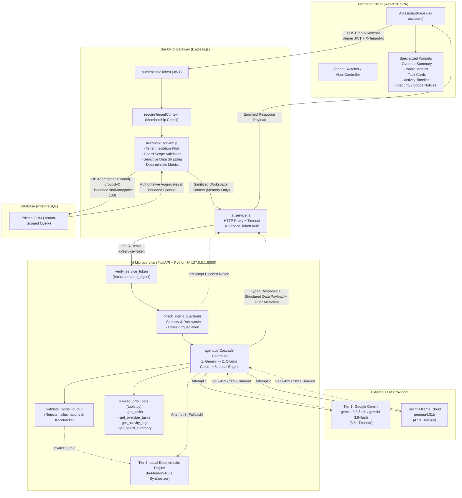

# JulleyOnline — Optional AI Kanban Assistant Specification & Architecture

This document provides the complete architecture, security model, response type classification, REST API specification, Python microservice implementation details, and verification evidence for the **Refined AI Kanban Assistant** in JulleyOnline.

---

## 1. Executive Summary & Purpose

The **AI Kanban Assistant** is an additive, optional, read-only intelligence extension designed to assist multi-tenant engineering and product teams. It answers natural-language workspace questions grounded strictly in authorized, real-time Kanban data, rendered via enterprise-grade UI components rather than raw plain text.

### Key Refinements Applied:
1. **Three-Tier Cascade (Gemini -> Ollama Cloud -> Local Engine):**
   - **Tier 1 (Google Gemini):** Primary LLM (`gemini-3.5-flash` / `gemini-3.8-flash`) with strict 3.5s fast-fail timeout to prevent gateway hangs.
   - **Tier 2 (Ollama Cloud):** Secondary LLM (`gemma4:31b` via `https://ollama.com/api/chat`), automatically invoked if Gemini encounters rate limits (`HTTP 429`), high-demand spikes (`HTTP 503`), or timeouts.
   - **Tier 3 (Local Deterministic Engine):** In-memory Python rule engine (`MOCK_LLM`), automatically invoked if all external LLMs fail or when running in offline/air-gapped environments.
2. **Three Configurable Response Modes (`AI_RESPONSE_MODE`):**
   - `auto` (default): Executes Tier 1 (Gemini) -> Tier 2 (Ollama Cloud) -> Tier 3 (Local Deterministic Fallback).
   - `local`: Executes the deterministic Python response engine directly without external network requests.
   - `llm`: Invokes Gemini then Ollama Cloud, returning HTTP 502 Bad Gateway if all external providers fail.
3. **Accurate Workspace Aggregations Beyond 100 Tasks:**
   - Database-level aggregations (`prisma.task.count` and `groupBy`) compute exact workspace metrics across all matching tasks in PostgreSQL, eliminating sampling distortion.
   - Context payload to LLMs remains strictly bounded to 100 detailed tasks and 30 activity records to preserve latency and token efficiency.
   - Responses explicitly differentiate exact total metrics from sampled card details when truncated.
4. **Transparent Generation Metadata Contract:** Every response includes authoritative provenance: `{ source: "llm" | "local" | "guardrail", provider: "gemini" | "ollama" | "local" | null, tier: 1 | 2 | 3 | null, model: string | null, fallbackUsed: boolean, failureReason?: string }`.
5. **Secure Internal Microservice Hardening:**
   - Fast-fail timeouts: 3.5s for Gemini, 4.5s for Ollama Cloud, 12–15s for Express gateway.
   - Constant-time service token comparison using `hmac.compare_digest`.
   - Default binding to loopback `127.0.0.1` and removal of open wildcard CORS.
   - Production validation preventing insecure default service tokens.
   - Sanitized client error responses without leaking internal stack traces.
6. **Subtle Enterprise UX on Fallback:** When fallback occurs, the UI displays an informational indicator (*"Answered using local workspace analysis"* or Ollama Cloud) and reflects the source in the disclosure without alarming users with raw technical error codes.
7. **Explicit, Validated Response Types:** System classifies answers into typed categories (`overdue_summary`, `board_summary`, `task_list`, `activity_summary`, `scope_notice`, `security_notice`, `general_answer`) to render tailored interactive widgets.
8. **Intent Gating Guardrails:** Dedicated pre-execution security layer protects credentials and cross-organization boundaries before calling tools or LLM APIs.
9. **Safe Markdown Rendering:** Clean typography with zero raw markdown syntax leaks (`**bold**` parsed into semantic bold, styled bullet points, and code badges).
10. **Tool Details Clutter Reduction:** Replaced raw tool name dumps with a clean summary footer (records analyzed, data scope, timestamp) and a subtle expandable *"How this answer was generated"* disclosure showing Generation Source, Model, and Allowlisted Tools.

---

## 2. Architecture & Trust Boundaries

The system follows a strict gateway architecture where the Python AI microservice has **zero direct database access**. The existing Express application acts as the single source of truth, enforcing authentication, RBAC, tenant isolation, and data sanitization.



---

## 3. Strict Security & Multi-Tenancy Isolation

### Zero Database Access for Python
- The Python service does **not** have database connection strings, credentials, or Prisma client access.
- It operates strictly as a stateless, in-memory function processing the sanitized JSON context forwarded by Express.

### Intent Gating & Guardrails (Independent of LLM)
- **Credential Protection (`security_notice`):** Inquiries attempting to discover user passwords, password hashes, secrets, or API keys are immediately intercepted. The system returns an educational security notice without querying tools or invoking external LLMs.
- **Cross-Organization Protection (`scope_notice`):** Inquiries requesting projects, boards, or data from other organizations are rejected with an explicit notice explaining the active workspace boundary and directing the user to the top navigation workspace switcher.

### Data Minimization & Privacy Protection
Before sending data to the AI service, Express strips all sensitive fields:
- User email addresses, passwords, password hashes, and external tokens are removed.
- Only display names (`user.name`), task titles, descriptions, priorities, column statuses, and audit timestamps are forwarded.

### Tenant-Switching Race-Condition Protections
- When a user changes workspaces in the UI:
  1. Any in-flight HTTP request to `/api/v1/ai/chat` is immediately aborted via `AbortController.abort()`.
  2. The local `requestIdRef` counter increments, discarding any late-arriving responses from previous tenants.
  3. The chat history, selected board state, and input state are immediately cleared.

---

## 4. Allowlisted Read-Only Tools

The Python microservice exposes 4 strictly read-only tools defined in `ai-service/tools.py`:

| Tool Name | Parameters | Purpose | Return Value |
|---|---|---|---|
| `get_tasks` | `board_id?: str`, `column_id?: str`, `priority?: str`, `assignee_id?: str` | Filters tasks in the active workspace | Array of matching sanitized task objects |
| `get_overdue_tasks` | `board_id?: str` | Computes incomplete tasks past their due date relative to UTC | Overdue task objects, total analyzed, with/without due date counts |
| `get_activity_logs` | `limit: int = 10`, `action?: str`, `entity_type?: str` | Retrieves recent audit log entries in chronological order | Formatted list of workspace activity events |
| `get_board_summary` | `board_id?: str` | Generates aggregate counts, column distributions, and completion % | Summary dictionary with task totals and stage breakdowns |

---

## 5. Explicit Response Types & Presentation Widgets

Rather than returning unstructured blobs of plain text, the assistant returns typed responses:

| `responseType` | UI Presentation Component | Key Data Payload |
|---|---|---|
| `overdue_summary` | 3-card metric bar (Analyzed, Overdue, With Due Date) + overdue task card list with days past due tags. If 0 tasks have due dates, renders an informative alert. | `tasksAnalyzed`, `overdueCount`, `tasksWithDueDates`, `tasksWithoutDueDates`, `tasks` |
| `board_summary` | 4-stat metric row (Total, Pending, Completed %, Overdue) + column breakdown tags + priority pills. | `total_tasks`, `pending_tasks`, `completed_tasks`, `completion_percentage`, `by_column`, `by_priority` |
| `task_list` | Filtered list of task cards with priority badges, column tags, assignee, and due dates. | `totalTasks`, `tasks`, `filterType` |
| `activity_summary` | Chronological activity cards with actor avatar, action description, and timestamp. | `returnedRecords`, `activities` |
| `scope_notice` | Boundary card explaining active tenant workspace and switcher navigation. | `noticeType`, `activeWorkspace`, `reason` |
| `security_notice` | Protected credential card explaining encrypted authentication boundary. | `noticeType`, `status`, `reason` |
| `general_answer` | Clean formatted markdown response with executive summary. | Context metrics |

---

## 6. Screenshots & Visual Interface

### Desktop Experience (`docs/ai_assistant_desktop.png`)


### Mobile Responsive Experience (`docs/ai_assistant_mobile.png`)


---

## 7. Python Microservice (`ai-service/`) Configuration

```bash
cd ai-service

# Create and activate virtual environment
py -m venv venv
.\venv\Scripts\activate   # Windows
# source venv/bin/activate # Linux/macOS

# Install dependencies
pip install -r requirements.txt

# Start microservice with Uvicorn
uvicorn main:app --host 127.0.0.1 --port 8000 --reload
```

### Environment Variables (`ai-service/.env`)
- `AI_RESPONSE_MODE`: Operating mode (`auto` [default], `local`, or `llm`).
- `MOCK_LLM`: Backward-compatible override. When `true`, forces `local` mode.
- `GEMINI_API_KEY`: Google Gemini API key.
- `AI_MODEL`: Primary Gemini model (`gemini-3.5-flash` or `gemini-3.8-flash`).
- `FALLBACK_MODEL`: Secondary Gemini model (`gemini-3.8-flash`).
- `OLLAMA_API_KEY`: Ollama Cloud API key.
- `OLLAMA_BASE_URL`: Ollama endpoint (`https://ollama.com/api`).
- `OLLAMA_MODEL`: Ollama model (`gemma4:31b`).
- `AI_SERVICE_TOKEN`: Shared secret token for Express gateway (`dev-ai-service-token-secret`).

---

## 8. Automated Verification Evidence

The 3-tier cascade AI assistant (Gemini -> Ollama Cloud -> Local Deterministic Fallback) is verified across unit, security, integration, and browser automation test suites:

### 1. Python Unit, Security & Scenario Suite (`ai-service/tests/`)
- **32 passed, 0 failed (100% pass rate)**
- `test_agent.py` (25 tests):
  - **Case A (`test_case_a_no_due_dates`):** 11 tasks across 2 boards with no due dates -> returns 0 overdue, 11 analyzed, 0 with due dates, clear explanation.
  - **Case B (`test_case_b_other_organizations`):** Other organization queries -> returns `scope_notice`, 0 tools called.
  - **Case C (`test_case_c_account_password`):** Password inquiries -> returns `security_notice`, 0 tools called.
  - **Case D (`test_case_d_actual_overdue_tasks`):** Tasks with known UTC timestamps -> verified correct classification and days overdue.
  - **Test 1:** Valid Gemini response generates `source=llm`, `provider=gemini`, `tier=1`, `fallbackUsed=false`.
  - **Test 2:** Successful Gemini call does not invoke fallback engine.
  - **Tier 2 Test:** When Gemini fails, Ollama Cloud responds successfully with `source=llm`, `provider=ollama`, `tier=2`, `fallbackUsed=true`, `model="gemma4:31b (ollama)"`.
  - **Test 3:** Gemini HTTP 429 quota exhaustion and Ollama failure invokes local fallback (`source=local`, `provider=local`, `tier=3`).
  - **Test 4:** Gemini HTTP 503 transient service error and Ollama failure invokes local fallback.
  - **Test 5:** LLM request timeout automatically invokes deterministic fallback.
  - **Test 6:** Network disconnect / DNS failure triggers local fallback.
  - **Test 7:** Missing or invalid API key in `auto` mode falls back gracefully.
  - **Test 8:** Empty or malformed output from LLM triggers local fallback.
  - **Test 9:** `AI_RESPONSE_MODE=local` executes deterministic engine without network calls (`tier=3`).
  - **Test 10:** `AI_RESPONSE_MODE=llm` fails with HTTP 502 when both Gemini and Ollama fail, and does not use local fallback.
  - **Test 11:** Numerical statistics and records analyzed match identically between modes.
  - **Test 12:** Generation metadata contract is accurate across guardrail (`tier=null`), local (`tier=3`), fallback (`tier=2` or `3`), and LLM (`tier=1`) paths.
  - **Test 13:** Truncated task context (>100 tasks) accurately reports total workspace tasks vs analyzed sample.
  - **Test 14:** `validate_model_output` rejects empty, whitespace, tracebacks, or malformed responses.
- `test_security.py` (3 tests): Service token authentication via `hmac.compare_digest`, prompt injection resistance, schema rejection.
- `test_tools.py` (4 tests): Tool execution verification across overdue, activities, task lists, and board summaries.

### 2. Backend Express Gateway Suite (`backend/tests/ai.test.js`)
- **11 passed, 0 failed (100% pass rate)**
- Validates token authentication, tenant header scoping, foreign board rejection (`403 Forbidden`), sensitive data stripping, structured response propagation, and accurate fallback metadata forwarding (`TC-AI-09`).
- `TC-AI-10`: High-scale analytics test with 250 tasks in PostgreSQL across multiple boards. Validates that `prisma.task.groupBy` and `count` compute exact workspace aggregates (total tasks: 250, pending: 220, completed: 30, overdue: 40, priority distribution) while bounded context passes only 100 recent tasks without memory explosion.
- `TC-AI-11`: Three-tier provenance verification verifying correct propagation of `generation` fields (`source`, `provider`, `tier`, `fallbackUsed`).

### 3. Playwright Frontend End-to-End Suite (`frontend/tests/ai-assistant.spec.js`)
- **10 passed, 0 failed (100% pass rate)**
- `AI-01`: Header context, read-only indicator, and board selector verification.
- `AI-02`: Overdue query submission, structured widget rendering, and expandable tool disclosure toggle.
- `AI-03`: Tenant switching cancellation and chat state reset.
- `AI-04`: 503 error alert rendering and dismissal.
- `AI-05`: Case A zero-due-dates workspace verification.
- `AI-06`: Case B & C scope and security notice widget verification without tool clutter.
- `AI-07`: Keyboard interaction (Enter to send, Shift+Enter for newline) and mobile responsive layout (375x667).
- `AI-08`: Gemini LLM generation source displayed in disclosure (`Google Gemini — [model]`) without fallback banner.
- `AI-09`: Subtle local fallback indicator (*"Answered using local workspace analysis"*) and metadata displayed when LLM fails without exposing raw technical errors.
- `AI-10`: Ollama Cloud generation disclosure (`Ollama Cloud — [model]`) and secondary fallback indicator (*"Answered using Ollama Cloud secondary model"*).

### Full Regression Suite Status
- **Backend Tests:** 128 passed / 128 total (117 core + 11 AI tests).
- **Playwright E2E Tests:** 33 passed / 33 total (23 core + 10 AI tests).
- **Python Tests:** 32 passed / 32 total.
- **Total Automated Passing Tests:** **193 tests**.
