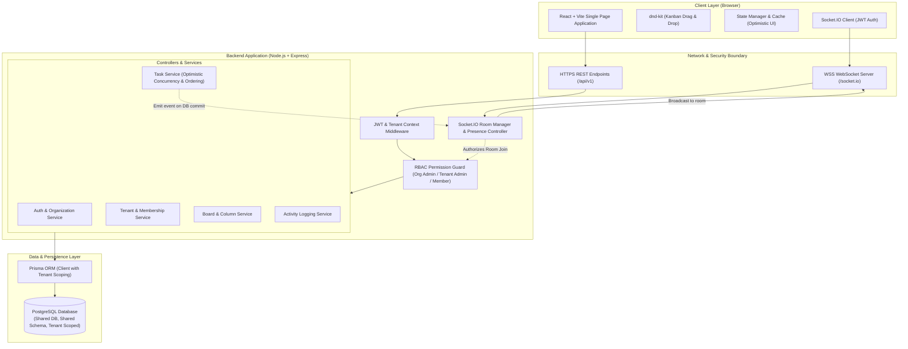

# System Architecture Specification

## 1. Overview & Architectural Goals

The **JulleyOnline Multi-Tenant Kanban System** is a real-time collaborative task management platform engineered for multi-tenant organizations. It allows companies to operate independent workspaces (tenants), manage user roles, organize work visually on Kanban boards, and collaborate concurrently with instantaneous updates.

### Core Architectural Principles
1. **Strict Tenant Isolation**: Data from one tenant must never be accessible or modifiable by another tenant, even within the same organization.
2. **Atomic Concurrency**: Collaborative edits to tasks must prevent race conditions and lost updates using version-based optimistic concurrency control.
3. **Guaranteed Consistency**: State transitions (e.g., moving a task, updating positions, logging activities) occur within transactional database boundaries.
4. **Resilient Real-Time Synchronization**: Sockets handle real-time broadcasts with strict server-side authorization; clients gracefully handle disconnects and re-sync without data corruption.
5. **Simplicity Over Complexity**: A clean modular monolith built with Express, Prisma, and React that minimizes operational overhead while maintaining production-grade security and reliability.

---

## 2. High-Level Architecture Diagram



---

## 3. Communication Flow: Frontend, Backend, Database, and Socket.IO

The system combines synchronous REST requests for transactional state mutations with asynchronous WebSockets for real-time broadcast and presence.

### 3.1 Synchronous REST Path (Mutation & Queries)
1. **Client Request**: Frontend issues an HTTP request with an `Authorization: Bearer <JWT>` header and an active tenant context header (`X-Tenant-ID: <uuid>`).
2. **Context Resolution**: The backend middleware validates the JWT, decodes user credentials, and confirms that the user has an active membership in the specified `X-Tenant-ID` (or is an Org Admin with org-wide scope).
3. **RBAC Verification**: Route guards verify whether the user's role satisfies the permission matrix for that resource.
4. **Database Transaction**: The service executes business logic inside a Prisma transaction (`prisma.$transaction`), ensuring atomic updates to tasks, integer ordering, and activity logs.
5. **PostgreSQL as Authoritative State**: PostgreSQL is the single source of truth (SSOT). State transitions are only finalized when the PostgreSQL transaction successfully commits.
6. **Event Dispatch**: Once the database transaction commits successfully, the server emits a real-time event to the corresponding Socket.IO room.
7. **HTTP Response**: The HTTP endpoint returns the mutated resource with updated version metadata.

### 3.2 Asynchronous Real-Time Path (Socket.IO) & Reliability Guarantees
1. **Connection & Authentication**: When the client connects, it provides the JWT in `socket.handshake.auth.token`. The server validates the token; invalid tokens trigger an immediate socket disconnect.
2. **Server-Side Room Authorization**:
   - Clients request to join a room by emitting `join:board { boardId, tenantId }`.
   - The server **does not trust client room claims**. It queries user memberships and verifies the board belongs to the specified `tenantId`.
   - Only upon verification does the server call `socket.join("tenant:<tenantId>:board:<boardId>")`.
3. **Best-Effort Delivery Notice**:
   - Socket.IO events are **not guaranteed delivery**. Packet loss, background browser throttling, or network hiccups may cause dropped or reordered events.
   - Sockets act as ephemeral signals to update UI views quickly. When strict certainty is required, clients rely on PostgreSQL-backed REST responses.
4. **Duplicate & Out-of-Order Event Handling**:
   - **Sender Protection**: Socket payloads include `actorId` and `clientRequestId`. The initiating client ignores incoming broadcasts matching its own inflight request, relying instead on the definitive HTTP REST response.
   - **Receiver Version Check**: Every task event carries the authoritative `version`.
     - If `event.version <= localTask.version`: The event is stale or duplicate $\to$ **safely discarded**.
     - If `event.version === localTask.version + 1`: The transition is contiguous $\to$ **applied immediately**.
     - If `event.version > localTask.version + 1`: An event was dropped/missed $\to$ client automatically triggers a fresh board-state fetch (`GET /api/v1/boards/:boardId`).
5. **Presence Tracking**:
   - An in-memory tracking structure associates sockets with users and board rooms.
   - When a user joins or disconnects, `presence:sync` events broadcast the current list of active viewing users to the board room.

---

## 4. Multi-Tenant Isolation Strategy & Membership Architecture

The application adopts a **Shared Database, Shared Schema** multi-tenancy model with distinct organization-level and tenant-level boundaries.

### 4.1 Secure Organization Registration & Initial Org Admin Creation
Bootstrapping a new organization occurs through a dedicated, atomic registration endpoint:
- **Endpoint**: `POST /api/v1/auth/register-org`
- **Atomic Bootstrap Workflow (`prisma.$transaction`)**:
  1. **Password Hashing**: Hash user password using bcrypt with a salt factor of 12.
  2. **User Creation**: Insert user record into `users` table with normalized email.
  3. **Organization Creation**: Create the root `organizations` record with a validated, unique slug (e.g., `acme-corp`).
  4. **Default Tenant Creation**: Provision a default workspace tenant (e.g. `Engineering` or `General Workspace`) under the organization.
  5. **Org-Level Membership**: Insert into `memberships` with `org_id = org.id`, `tenant_id = NULL`, and `role = ORG_ADMIN`.
  6. **Default Tenant Membership**: Insert into `memberships` with `org_id = org.id`, `tenant_id = defaultTenant.id`, and `role = TENANT_ADMIN`.
  7. **Activity Audit**: Record an immutable log entry marking organization initialization.
  8. **Token Issuance**: Return an authenticated JWT containing `userId`, active `orgId`, and default `tenantId`.

### 4.2 Organization-Level vs Tenant-Level Memberships
To prevent privilege escalation and ensure clear access scopes, memberships are split into two distinct tiers:

1. **Organization-Level Membership (`tenant_id IS NULL`, `role = ORG_ADMIN`)**:
   - Represents enterprise ownership.
   - Authorizes organization profile updates, billing management, creation of new tenants, deletion of tenants, inviting Org Admins, and supervisory read-only/audit access across all subordinate tenant boards.
   - Cannot be held by `TENANT_ADMIN` or `MEMBER` (those roles require an explicit `tenant_id`).

2. **Tenant-Level Membership (`tenant_id IS NOT NULL`, `role = TENANT_ADMIN` or `MEMBER`)**:
   - Scoped strictly to the specific tenant workspace.
   - **`TENANT_ADMIN`**: Can create and configure boards, manage columns, invite users to their specific tenant workspace, and delete tasks/boards within that tenant. Has **zero** authority over any other tenant in the organization.
   - **`MEMBER`**: Can view boards, create and edit tasks, move task cards, and assign tasks to teammates within their tenant workspace.
   - A single user may belong to multiple tenants in the same organization with different roles (e.g., `TENANT_ADMIN` in Tenant A, but `MEMBER` in Tenant B).

### 4.3 Query Hardening & Boundary Enforcement
- **Tenant Key Scoping**: Every tenant-owned table (`boards`, `columns`, `tasks`, `activity_logs`) possesses a foreign key `tenant_id` referencing `tenants(id)`.
- **Query Hardening**: Every query constructed at the service layer enforces `WHERE tenant_id = :currentTenantId`.
- **Cross-Entity Integrity Guards**:
  - Target column validation: When creating or moving a task, verify `column.tenant_id == req.tenant_id` and `column.board_id == task.board_id`.
  - Target assignee validation: When assigning a task, verify `assignee_user_id` has an active membership in the same `tenant_id`.
  - Violations result in an immediate `400 Bad Request` or `403 Forbidden` response.

---

## 5. Role-Based Access Control (RBAC) Permission Matrix

The application defines three roles:
1. **Org Admin**: Enterprise administrator with full control over the organization, its tenants, billing, and organizational policies.
2. **Tenant Admin**: Workspace administrator with control over a specific tenant, its boards, columns, and member invitations.
3. **Member**: Collaborator who participates in task management, column movement, assignments, and discussions within an authorized tenant.

### Role Scope & Permissions

| Resource / Action | Org Admin | Tenant Admin | Member | Scope & Enforcement Rule |
| :--- | :---: | :---: | :---: | :--- |
| **Organization: View & Update** | Yes | No | No | Org-level (`org_id`) |
| **Organization: Delete** | Yes | No | No | Org-level (`org_id`) |
| **Tenants: Create & Delete** | Yes | No | No | Org-level (`org_id`) |
| **Tenants: View & Switch** | Yes | Yes (Assigned) | Yes (Assigned) | Org Admin sees all org tenants; others see assigned tenants |
| **Memberships: Manage Org Admins**| Yes | No | No | Org-level (`org_id`) |
| **Memberships: Manage Tenant Roles**| Yes | Yes | No | Within assigned `tenant_id` |
| **Boards: Create & Delete** | Yes | Yes | No | Within assigned `tenant_id` |
| **Boards: View & List** | Yes | Yes | Yes | Within assigned `tenant_id` |
| **Columns: Create, Reorder, Delete**| Yes | Yes | No | Within assigned `tenant_id` and `board_id` |
| **Tasks: Create & Edit Details** | Yes | Yes | Yes | Within assigned `tenant_id` and `board_id` |
| **Tasks: Move & Reorder** | Yes | Yes | Yes | Within assigned `tenant_id` and `board_id` |
| **Tasks: Assign Users** | Yes | Yes | Yes | Assignee must belong to `tenant_id` |
| **Tasks: Delete** | Yes | Yes | Creator Only | Members can only delete tasks they created |
| **Activity Logs: View** | Yes | Yes | Yes | Scoped to active `tenant_id` and `board_id` |

---

## 6. Optimistic Concurrency Control (OCC) & Conflict Resolution

In a real-time collaborative Kanban board, two users might edit, move, or reorder the same task simultaneously. To eliminate silent overwrites ("lost updates") while maintaining a smooth user experience, the system strictly follows the conflict-handling model from the assignment preparation guide:

### 6.1 Core Concurrency Mechanisms
1. **Monotonic Task Version Numbers**: Every task record includes an integer column `version` starting at `1`. Every mutation (`title`, `description`, `assignee`, `column`, `position`, `priority`) increments this version by 1.
2. **Atomic Version Verification in PostgreSQL**:
   Update and move mutations never perform an unsafe "read-then-write". Instead, mutations execute an atomic conditional SQL statement inside a transaction:
   ```sql
   UPDATE tasks
   SET title = $1, description = $2, column_id = $3, position = $4,
       version = version + 1, updated_at = NOW()
   WHERE id = $5 AND tenant_id = $6 AND version = $7;
   ```
3. **HTTP 409 Conflict for Stale Updates**:
   - If `affectedRows === 1`: The mutation was accepted without contention; the server commits the transaction and returns HTTP 200 with the freshly updated task.
   - If `affectedRows === 0`: The task was concurrently modified by another peer. The server fetches the latest authoritative task state from PostgreSQL and returns **HTTP 409 Conflict** with payload:
     ```json
     {
       "success": false,
       "error": {
         "code": "CONFLICT",
         "message": "Task has been modified by another collaborator",
         "currentTask": { ... }
       }
     }
     ```

### 6.2 Frontend Conflict UX & Optimistic Rollback
1. **Optimistic UI with Rollback**: When a user drags a card or saves an edit, the client updates the UI optimistically while the REST request is in-flight.
2. **Conflict Notification & Working Refresh Action**:
   - When the client receives an HTTP 409 response, it triggers an immediate visual conflict notification banner/toast: *"Conflict detected: This task was modified by another teammate."*
   - The notification provides a clear **"Refresh to latest state"** action button.
   - Upon clicking "Refresh" (or automatically on modal dismiss), the client discards its stale optimistic change and rolls back local UI state to the authoritative server task provided in the 409 response body (or triggers a full board snapshot fetch).
3. **Simultaneous Task Edits, Moves & Ordering Conflicts**:
   - **Simultaneous Edit & Move**: User A edits task description while User B moves the task to "Done". User B commits first (version 1 $\to$ 2). User A's update fails atomically (version mismatch), returns 409, and User A is shown the card in "Done" with option to refresh before re-submitting.
   - **Simultaneous Moves**: User A and User B drag the same card to different columns simultaneously. The first commit succeeds; the second receives 409 Conflict, snaps the card to the first user's chosen column, and preserves column ordering integrity.
4. **Deliberate Non-Goals (Scope Boundary)**:
   - **No complex automatic three-way merging**: We do not attempt Git-style diff merging of text fields.
   - **No collaborative operational transform (OT) or CRDT text editing**: Simple, deterministic version-based OCC with user notification and authoritative rollback.

---

## 7. Reliable Transaction-Safe Integer Task Ordering Strategy

Kanban boards require deterministic, transaction-safe task ordering without gaps or race conditions. For this prototype, we utilize **contiguous zero-based integer ordering** (`0, 1, 2, ...`).

### 7.1 Single-Column Reordering
When task $T$ is moved from `oldIndex` to `newIndex` within column $C$:
- Executed inside a single `prisma.$transaction`:
  1. If `newIndex < oldIndex` (moving card upwards):
     ```sql
     UPDATE tasks
     SET position = position + 1
     WHERE column_id = $columnId AND position >= $newIndex AND position < $oldIndex AND id != $taskId;
     ```
  2. If `newIndex > oldIndex` (moving card downwards):
     ```sql
     UPDATE tasks
     SET position = position - 1
     WHERE column_id = $columnId AND position <= $newIndex AND position > $oldIndex AND id != $taskId;
     ```
  3. Update target task:
     ```sql
     UPDATE tasks
     SET position = $newIndex, version = version + 1
     WHERE id = $taskId AND version = $clientVersion;
     ```

### 7.2 Cross-Column Moves
When task $T$ is moved from `sourceColumn` at `sourceIndex` to `targetColumn` at `targetIndex`:
- Executed inside a single `prisma.$transaction`:
  1. Close the gap in source column:
     ```sql
     UPDATE tasks
     SET position = position - 1
     WHERE column_id = $sourceColumnId AND position > $sourceIndex;
     ```
  2. Make space in target column:
     ```sql
     UPDATE tasks
     SET position = position + 1
     WHERE column_id = $targetColumnId AND position >= $targetIndex;
     ```
  3. Update target task:
     ```sql
     UPDATE tasks
     SET column_id = $targetColumnId, position = $targetIndex, version = version + 1
     WHERE id = $taskId AND version = $clientVersion;
     ```
- **Benefits**:
  - Deterministic and perfectly contiguous indices.
  - Zero floating-point rounding or precision degradation.
  - Guaranteed transactional consistency.

---

## 8. Disconnection, Reconnection, and Resynchronization Workflow

When a client loses network connectivity (e.g., WiFi fluctuation, laptop sleep):
1. **Network Detection & Reconnect**: The Socket.IO client detects the broken connection and automatically begins reconnection attempts with exponential backoff.
2. **Room Re-Entry**: Upon reconnection, the client issues `join:board { boardId, tenantId }` with its valid JWT. The server authorizes membership before rejoining the socket room.
3. **Fresh Authorized Board-State Fetch**:
   - Rather than relying on unreliable timestamp deltas, the client issues a single REST request:
     `GET /api/v1/boards/:boardId`
   - The backend validates current tenant authorization and returns the full authoritative board snapshot (columns, ordered tasks, versions, assignees).
   - The client replaces its local board cache with this authoritative snapshot.
   - Any stale local state, missed drops, or concurrent edits are resolved cleanly without drift.

---

## 9. API & WebSocket Contracts

### 9.1 REST API Endpoints

#### Authentication & Profile
- `POST /api/v1/auth/register` — Register a new user, bootstrap default organization, and assign initial Org Admin
- `POST /api/v1/auth/login` — Authenticate credentials, rate-limit brute force, and issue JWT
- `POST /api/v1/auth/logout` — Logout user (client purges JWT; documents stateless token window)
- `GET /api/v1/auth/me` — Retrieve authenticated user profile and memberships

##### Stateless JWT Logout Specification
In our architecture, JWTs are signed with a cryptographic HMAC-SHA256 secret key and are self-contained. The server does not maintain server-side session cookies. When a user logs out:
1. The frontend securely clears the token from in-memory state / localStorage.
2. The server responds with HTTP 200 confirming token discard.
3. The token remains cryptographically valid until its expiration window elapses.
4. If immediate hard-revocation is required before natural expiration, our database-backed membership checks ensure that any revoked or demoted user account is immediately blocked by `requireTenantContext` and `authenticateToken` querying PostgreSQL on every protected request.

#### Organizations & Tenants
- `GET /api/v1/organizations` — List organizations accessible by user
- `POST /api/v1/organizations` — Create a new organization (Org Admin)
- `GET /api/v1/organizations/:orgId/tenants` — List tenants for an organization
- `POST /api/v1/organizations/:orgId/tenants` — Create a new tenant (Org Admin)
- `GET /api/v1/tenants/:tenantId/members` — List members of a tenant
- `POST /api/v1/tenants/:tenantId/members` — Invite/add member to tenant (Admin)

#### Boards & Columns
- `GET /api/v1/boards` — List boards for active tenant
- `POST /api/v1/boards` — Create board in active tenant
- `GET /api/v1/boards/:boardId` — Get board detail with columns and tasks
- `DELETE /api/v1/boards/:boardId` — Delete board (Tenant Admin / Org Admin)
- `POST /api/v1/boards/:boardId/columns` — Create column
- `PATCH /api/v1/columns/:columnId/position` — Reorder column

#### Tasks & Activities
- `POST /api/v1/boards/:boardId/tasks` — Create task
- `PATCH /api/v1/tasks/:taskId` — Update task details (title, description, assignee, priority, version check)
- `PATCH /api/v1/tasks/:taskId/move` — Move task across columns or reorder (requires `columnId`, `position`, `version`)
- `DELETE /api/v1/tasks/:taskId` — Delete task
- `GET /api/v1/boards/:boardId/activities` — Get recent activity logs for board

### 9.2 WebSocket Event Contract

| Event Name | Direction | Payload | Description |
| :--- | :--- | :--- | :--- |
| `join:board` | Client $\to$ Server | `{ boardId, tenantId }` | Request to enter authorized board room |
| `leave:board` | Client $\to$ Server | `{ boardId, tenantId }` | Exit board room |
| `board:joined` | Server $\to$ Client | `{ boardId, activeUsers }` | Confirm room entry with active presence |
| `task:created` | Server $\to$ Client | `{ task, actor }` | Broadcast new task added to column |
| `task:updated` | Server $\to$ Client | `{ task, actor }` | Broadcast task field changes |
| `task:moved` | Server $\to$ Client | `{ taskId, sourceColumnId, targetColumnId, position, version, actor }` | Broadcast task drag-and-drop move |
| `task:deleted` | Server $\to$ Client | `{ taskId, columnId, actor }` | Broadcast task removal |
| `presence:sync` | Server $\to$ Client | `{ boardId, activeUsers: [{ id, name, avatarUrl }] }` | Active users presence update |

---

## 10. Core Acceptance Test Specifications

To guarantee architectural correctness and security, five mandatory acceptance test suites are defined:

### 10.1 Suite 1: JWT Authentication & Token Lifecycle
- **Test 1.1**: Valid credentials return HTTP 200 with JWT containing `userId` and user profile.
- **Test 1.2**: Requests with missing, expired, or tampered tokens return HTTP 401 Unauthorized.
- **Test 1.3**: Authenticated user can fetch their own profile and associated organizations/tenants via `GET /api/v1/auth/me`.

### 10.2 Suite 2: Role Escalation Prevention
- **Test 2.1**: A `MEMBER` attempting to create a new column or board is rejected with HTTP 403 Forbidden.
- **Test 2.2**: A `TENANT_ADMIN` attempting to create a new tenant or delete the organization is rejected with HTTP 403 Forbidden.
- **Test 2.3**: A `MEMBER` attempting to promote their own or another user's role is rejected with HTTP 403 Forbidden.

### 10.3 Suite 3: Cross-Tenant Data Isolation
- **Test 3.1**: User authenticated in Tenant A cannot query boards or tasks belonging to Tenant B (`GET /api/v1/boards/:tenantBBoardId` returns HTTP 403 or 404).
- **Test 3.2**: User cannot move a task into a column belonging to a different tenant (returns HTTP 400 or 403).
- **Test 3.3**: User cannot assign a task to a user who is not a member of the active tenant (returns HTTP 400).

### 10.4 Suite 4: Atomic Task Edits & Optimistic Concurrency (HTTP 409)
- **Test 4.1**: Sequential task updates with matching versions increment `version` and return HTTP 200.
- **Test 4.2**: Concurrent update test: Client A and Client B read task at `version: 1`. Client A submits update with `version: 1` $\to$ succeeds, version becomes `2`. Client B submits update with `version: 1` $\to$ server rejects with HTTP 409 Conflict and includes the current task state.
- **Test 4.3**: Task position reordering updates contiguous indices within a single transaction without gap anomalies.

### 10.5 Suite 5: Unauthorized Socket Joins & Eavesdropping Prevention
- **Test 5.1**: Unauthenticated socket handshake (missing or invalid JWT) is rejected immediately.
- **Test 5.2**: Authenticated socket emits `join:board` for a board in a tenant the user is NOT a member of $\to$ server denies room entry and emits `error:unauthorized`.
- **Test 5.3**: Broadcast events emitted to `tenant:A:board:X` are never received by a client listening on `tenant:B:board:Y`.


---

# 12. Phase 4: Real-Time Collaboration, Concurrency & Recovery

## 12.1 Socket.IO Server & Room Architecture
- **Server Instance**: Attached directly to Node.js `httpServer` in `backend/src/server.js`.
- **JWT Handshake Authentication**: `io.use()` validates Bearer token from handshake headers or auth payload, extracting `socket.user` from PostgreSQL. Forged or expired tokens are immediately rejected with an Authentication error.
- **Room Naming Convention**: `tenant:<tenantId>:board:<boardId>`.
- **Database Authorization**: On `join:board`, the socket handler queries PostgreSQL to verify the user holds active membership in `tenantId` (or Org Admin role in the tenant's organization). Unauthorized or cross-tenant join requests are blocked and rejected with `error:unauthorized`.

## 12.2 Real-Time Presence & Multi-Tab Handling
- **Multi-Tab Tracking**: `presenceMap` tracks room presence as `Map<roomKey, Map<userId, { user, socketIds: Set<string> }>>`.
- **Clean Invariants**:
  - Connecting from a second browser tab registers another socket ID for the user without duplicating the user in the presence avatar stack.
  - Closing one tab leaves the user online as long as other tabs remain open.
  - Closing the last active tab broadcasts updated room presence via `presence:sync`.
  - Revoking membership (`revokeUserFromTenant`) disconnects all sockets for that user in the tenant's rooms and immediately clears presence.

## 12.3 Broadcast Protocol & Post-Commit Emission
Every mutation broadcasts only **after** the PostgreSQL transaction successfully commits:
| Event Name | Direction | Payload Structure | Trigger |
| :--- | :--- | :--- | :--- |
| `task:created` | Server $\to$ Room | `{ eventId, type, boardId, tenantId, task, version }` | `POST /api/v1/boards/:boardId/tasks` |
| `task:updated` | Server $\to$ Room | `{ eventId, type, boardId, tenantId, task, version }` | `PUT /api/v1/tasks/:taskId` |
| `task:moved` | Server $\to$ Room | `{ eventId, type, boardId, tenantId, task, targetColumnId, newPosition, version }` | `POST /api/v1/tasks/:taskId/move` |
| `task:deleted` | Server $\to$ Room | `{ eventId, type, boardId, tenantId, taskId, columnId }` | `DELETE /api/v1/tasks/:taskId` |
| `column:created`| Server $\to$ Room | `{ eventId, type, boardId, tenantId, column }` | `POST /api/v1/boards/:boardId/columns` |
| `column:updated`| Server $\to$ Room | `{ eventId, type, boardId, tenantId, column }` | `PUT /api/v1/columns/:columnId` |
| `column:deleted`| Server $\to$ Room | `{ eventId, type, boardId, tenantId, columnId }` | `DELETE /api/v1/columns/:columnId` |
| `presence:sync` | Server $\to$ Room | `{ boardId, tenantId, activeUsers, timestamp }` | Join, leave, disconnect, or revocation |

## 12.4 Concurrency, Optimistic Locking & Conflict Recovery
- **Atomic Optimistic Locking**: Tasks include a monotonic integer `version` incremented on every mutation.
- **OCC Conflict (HTTP 409)**: If incoming version $\neq$ database version, update returns HTTP 409 Conflict with `{ currentTask: authoritativeSnapshot }`.
- **Conflict Modal**: Frontend displays latest server state side-by-side with user's stale edits, allowing one-click reconciliation to authoritative state.
- **Undo / Redo Safety**: Undo and Redo operations execute authorized reversal mutations passing the task's current monotonic version. If a collaborator updated the task in the meantime, the server rejects the undo with HTTP 409 Conflict, alerting the user and preserving collaborator work.
- **Reconnection Recovery**: Upon reconnection, client re-authenticates, rejoins the board room, and triggers an authoritative snapshot fetch (`GET /api/v1/boards/:id`) to reconcile missed events.
