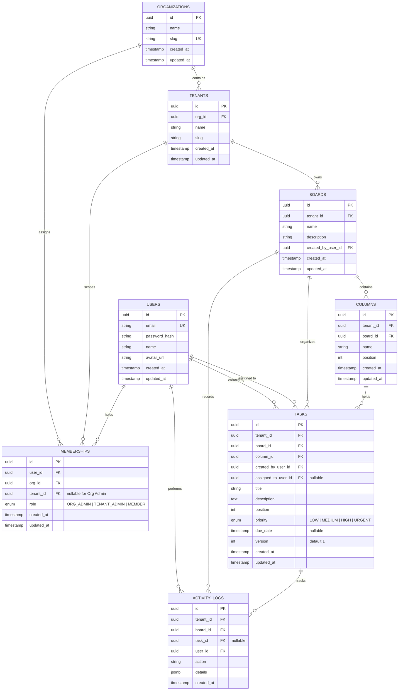

# Database Schema & Data Integrity Design

## 1. Overview & Data Modeling Strategy

The JulleyOnline Kanban data layer is designed for **strict multi-tenant isolation**, **atomic concurrency**, and **high read/write throughput**. The architecture employs a **Shared Database, Shared Schema** design pattern where tenant data lives within common tables but is strictly partitioned through `tenant_id` foreign keys and indexed query paths.

---

## 2. Entity-Relationship (ER) Diagram



---

## 3. Table Definitions & Field Specifications

### 3.1 `organizations`
Represents the top-level business organization (e.g., enterprise client or company).
- `id` (UUID, Primary Key, Default: `gen_random_uuid()`): Unique organization identifier.
- `name` (VARCHAR(255), NOT NULL): Legal or display name of the organization.
- `slug` (VARCHAR(100), UNIQUE, NOT NULL): URL-safe identifier (e.g. `acme-corp`).
- `created_at` (TIMESTAMPTZ, NOT NULL, DEFAULT: `NOW()`).
- `updated_at` (TIMESTAMPTZ, NOT NULL, DEFAULT: `NOW()`).

### 3.2 `tenants`
Independent workspace subdivisions within an organization (e.g., departments, teams, clients).
- `id` (UUID, Primary Key, Default: `gen_random_uuid()`): Unique tenant identifier.
- `org_id` (UUID, NOT NULL, FK $\to$ `organizations.id` ON DELETE CASCADE): Parent organization.
- `name` (VARCHAR(255), NOT NULL): Tenant workspace name.
- `slug` (VARCHAR(100), NOT NULL): URL-friendly slug unique within the organization.
- `created_at` (TIMESTAMPTZ, NOT NULL, DEFAULT: `NOW()`).
- `updated_at` (TIMESTAMPTZ, NOT NULL, DEFAULT: `NOW()`).
- **Constraints**: `UNIQUE (org_id, slug)`.

### 3.3 `users`
Global user identity credentials and personal profile.
- `id` (UUID, Primary Key, Default: `gen_random_uuid()`): Unique user identifier.
- `email` (VARCHAR(255), UNIQUE, NOT NULL): Normalized lowercase email address.
- `password_hash` (VARCHAR(255), NOT NULL): Secure bcrypt salted hash.
- `name` (VARCHAR(255), NOT NULL): Full display name.
- `avatar_url` (VARCHAR(1024), NULLABLE): Optional profile picture URL.
- `created_at` (TIMESTAMPTZ, NOT NULL, DEFAULT: `NOW()`).
- `updated_at` (TIMESTAMPTZ, NOT NULL, DEFAULT: `NOW()`).

### 3.4 `memberships`
Binds a user to an organization and optionally to a specific tenant workspace with a designated role.
- `id` (UUID, Primary Key, Default: `gen_random_uuid()`).
- `user_id` (UUID, NOT NULL, FK $\to$ `users.id` ON DELETE CASCADE).
- `org_id` (UUID, NOT NULL, FK $\to$ `organizations.id` ON DELETE CASCADE).
- `tenant_id` (UUID, NULLABLE, FK $\to$ `tenants.id` ON DELETE CASCADE): If NULL and role is `ORG_ADMIN`, user has org-wide administrative authority across all tenants. If populated, scopes permissions to that specific tenant.
- `role` (ENUM: `ORG_ADMIN`, `TENANT_ADMIN`, `MEMBER`, NOT NULL): Assigned RBAC role.
- `created_at` (TIMESTAMPTZ, NOT NULL, DEFAULT: `NOW()`).
- `updated_at` (TIMESTAMPTZ, NOT NULL, DEFAULT: `NOW()`).
- **Constraints**:
  - `UNIQUE (user_id, org_id, tenant_id)` (Null values handled appropriately in PostgreSQL via unique partial index or normalized records).

### 3.5 `boards`
Kanban boards dedicated to a specific tenant project.
- `id` (UUID, Primary Key, Default: `gen_random_uuid()`).
- `tenant_id` (UUID, NOT NULL, FK $\to$ `tenants.id` ON DELETE CASCADE): Partition key for tenant isolation.
- `name` (VARCHAR(255), NOT NULL): Board title (e.g., "Sprint 24 Board").
- `description` (TEXT, NULLABLE): Board summary.
- `created_by_user_id` (UUID, NOT NULL, FK $\to$ `users.id` ON DELETE RESTRICT).
- `created_at` (TIMESTAMPTZ, NOT NULL, DEFAULT: `NOW()`).
- `updated_at` (TIMESTAMPTZ, NOT NULL, DEFAULT: `NOW()`).

### 3.6 `columns`
Workflow stages within a board (e.g., "Backlog", "In Progress", "Code Review", "Done").
- `id` (UUID, Primary Key, Default: `gen_random_uuid()`).
- `tenant_id` (UUID, NOT NULL, FK $\to$ `tenants.id` ON DELETE CASCADE): Redundant tenant foreign key for fast index lookups and isolation verification without board joins.
- `board_id` (UUID, NOT NULL, FK $\to$ `boards.id` ON DELETE CASCADE).
- `name` (VARCHAR(100), NOT NULL): Column header.
- `position` (INTEGER, NOT NULL): 0-indexed integer position for column layout.
- `created_at` (TIMESTAMPTZ, NOT NULL, DEFAULT: `NOW()`).
- `updated_at` (TIMESTAMPTZ, NOT NULL, DEFAULT: `NOW()`).

### 3.7 `tasks`
Work items tracked across columns.
- `id` (UUID, Primary Key, Default: `gen_random_uuid()`).
- `tenant_id` (UUID, NOT NULL, FK $\to$ `tenants.id` ON DELETE CASCADE): Partition key for tenant isolation.
- `board_id` (UUID, NOT NULL, FK $\to$ `boards.id` ON DELETE CASCADE).
- `column_id` (UUID, NOT NULL, FK $\to$ `columns.id` ON DELETE CASCADE).
- `created_by_user_id` (UUID, NOT NULL, FK $\to$ `users.id` ON DELETE RESTRICT): Creator of the task.
- `assigned_to_user_id` (UUID, NULLABLE, FK $\to$ `users.id` ON DELETE SET NULL): Assignee within the same tenant.
- `title` (VARCHAR(255), NOT NULL): Task headline.
- `description` (TEXT, NULLABLE): Task markdown details.
- `position` (INTEGER, NOT NULL): 0-indexed integer position within the column.
- `priority` (ENUM: `LOW`, `MEDIUM`, `HIGH`, `URGENT`, NOT NULL, DEFAULT: `MEDIUM`).
- `due_date` (TIMESTAMPTZ, NULLABLE): Optional deadline.
- `version` (INTEGER, NOT NULL, DEFAULT: `1`): Monotonically increasing version counter for Optimistic Concurrency Control.
- `created_at` (TIMESTAMPTZ, NOT NULL, DEFAULT: `NOW()`).
- `updated_at` (TIMESTAMPTZ, NOT NULL, DEFAULT: `NOW()`).

### 3.8 `activity_logs`
Audit trail of user actions within boards and tasks.
- `id` (UUID, Primary Key, Default: `gen_random_uuid()`).
- `tenant_id` (UUID, NOT NULL, FK $\to$ `tenants.id` ON DELETE CASCADE).
- `board_id` (UUID, NOT NULL, FK $\to$ `boards.id` ON DELETE CASCADE).
- `task_id` (UUID, NULLABLE, FK $\to$ `tasks.id` ON DELETE SET NULL).
- `user_id` (UUID, NOT NULL, FK $\to$ `users.id` ON DELETE CASCADE).
- `action` (VARCHAR(50), NOT NULL): Action identifier (e.g., `TASK_CREATED`, `TASK_MOVED`, `TASK_ASSIGNED`).
- `details` (JSONB, NOT NULL, DEFAULT: `'{}'::jsonb`): Contextual payload (previous column, new column, previous version, etc.).
- `created_at` (TIMESTAMPTZ, NOT NULL, DEFAULT: `NOW()`).

---

## 4. Indexing Strategy for Fast Multi-Tenant Queries

PostgreSQL B-Tree indexes are configured for multi-tenant query patterns:

| Table | Index Name | Indexed Columns | Purpose |
| :--- | :--- | :--- | :--- |
| `tenants` | `idx_tenants_org_slug` | `(org_id, slug)` | Fast tenant lookup during workspace switching |
| `memberships` | `idx_memberships_user_tenant` | `(user_id, tenant_id)` | Fast authorization checks in middleware |
| `memberships` | `idx_memberships_tenant_user` | `(tenant_id, user_id)` | List all users in a tenant workspace |
| `boards` | `idx_boards_tenant_created` | `(tenant_id, created_at DESC)` | Render tenant board dashboard sorted by recency |
| `columns` | `idx_columns_board_position` | `(board_id, position ASC)` | Render columns in ordered sequence |
| `tasks` | `idx_tasks_column_position` | `(column_id, position ASC)` | Render tasks within a column in display order |
| `tasks` | `idx_tasks_tenant_id` | `(tenant_id, id)` | Fast scoped lookups and tenant boundary enforcement |
| `activity_logs` | `idx_activity_board_created` | `(board_id, created_at DESC)` | Render real-time board activity feed |

---

## 5. Security & Tenant Isolation Rules

### 5.1 Scoped Queries
All database operations initiated by incoming requests MUST bind to the active tenant ID authenticated in the request context:
```typescript
// Example Prisma query pattern
const task = await prisma.task.findFirst({
  where: {
    id: taskId,
    tenantId: req.user.currentTenantId, // Non-negotiable tenant scoping
  },
});
```

### 5.2 Cross-Entity Foreign Key Validation
When a task is updated or moved:
1. Target column validation: Ensure `column.boardId === task.boardId` and `column.tenantId === req.user.currentTenantId`.
2. Target assignee validation: Ensure `assigneeId` is a member of `req.user.currentTenantId`.
This prevents cross-tenant contamination (e.g., assigning a task to an external user or moving a card into a column of an unauthorized tenant).

---

## 6. Concurrency & Transaction Boundaries

### 6.1 Atomic Task Move Operation
Task moves must update column, position, version, and record an activity log atomically.

```typescript
await prisma.$transaction(async (tx) => {
  // 1. Verify target column belongs to the same board and tenant
  const column = await tx.column.findFirst({
    where: { id: targetColumnId, boardId, tenantId },
  });
  if (!column) throw new NotFoundError("Target column not found in this board");

  // 2. Perform atomic conditional update with version check
  const updateResult = await tx.task.updateMany({
    where: {
      id: taskId,
      tenantId,
      boardId,
      version: clientVersion, // Optimistic Lock Guard
    },
    data: {
      columnId: targetColumnId,
      position: newPosition,
      version: { increment: 1 },
      updatedAt: new Date(),
    },
  });

  // 3. Handle Concurrency Conflict
  if (updateResult.count === 0) {
    const existing = await tx.task.findFirst({ where: { id: taskId, tenantId } });
    if (!existing) throw new NotFoundError("Task not found");
    throw new ConflictError("Task was modified by another user", existing);
  }

  // 4. Create Activity Log within the same transaction
  await tx.activityLog.create({
    data: {
      tenantId,
      boardId,
      taskId,
      userId: req.user.id,
      action: "TASK_MOVED",
      details: { fromColumnId: oldColumnId, toColumnId: targetColumnId, position: newPosition },
    },
  });
});

// 5. Emit WebSocket event ONLY after transaction commits successfully
socketServer.to(`tenant:${tenantId}:board:${boardId}`).emit("task:moved", eventPayload);
```

### 6.2 Guaranteed Transaction Emission Rule
Socket broadcasts must **never** be executed inside the database transaction block. If the transaction aborts or rolls back, uncommitted changes must not be broadcast to connected clients.

---

## 7. Authoritative Eight-Table Prisma Schema

The complete Prisma Schema file representing the eight tables, constraints, relationships, and indexes:

```prisma
datasource db {
  provider = "postgresql"
  url      = env("DATABASE_URL")
}

generator client {
  provider = "prisma-client-js"
}

enum Role {
  ORG_ADMIN
  TENANT_ADMIN
  MEMBER
}

enum Priority {
  LOW
  MEDIUM
  HIGH
  URGENT
}

model Organization {
  id          String       @id @default(uuid()) @db.Uuid
  name        String       @db.VarChar(255)
  slug        String       @unique @db.VarChar(100)
  createdAt   DateTime     @default(now()) @map("created_at") @db.Timestamptz
  updatedAt   DateTime     @updatedAt @map("updated_at") @db.Timestamptz

  tenants     Tenant[]
  memberships Membership[]

  @@map("organizations")
}

model Tenant {
  id           String        @id @default(uuid()) @db.Uuid
  orgId        String        @map("org_id") @db.Uuid
  name         String        @db.VarChar(255)
  slug         String        @db.VarChar(100)
  createdAt    DateTime      @default(now()) @map("created_at") @db.Timestamptz
  updatedAt    DateTime      @updatedAt @map("updated_at") @db.Timestamptz

  organization Organization  @relation(fields: [orgId], references: [id], onDelete: Cascade)
  memberships  Membership[]
  boards       Board[]
  columns      Column[]
  tasks        Task[]
  activityLogs ActivityLog[]

  @@unique([orgId, slug])
  @@index([orgId, slug], name: "idx_tenants_org_slug")
  @@map("tenants")
}

model User {
  id           String        @id @default(uuid()) @db.Uuid
  email        String        @unique @db.VarChar(255)
  passwordHash String        @map("password_hash") @db.VarChar(255)
  name         String        @db.VarChar(255)
  avatarUrl    String?       @map("avatar_url") @db.VarChar(1024)
  createdAt    DateTime      @default(now()) @map("created_at") @db.Timestamptz
  updatedAt    DateTime      @updatedAt @map("updated_at") @db.Timestamptz

  memberships   Membership[]
  createdBoards Board[]       @relation("BoardCreator")
  createdTasks  Task[]        @relation("TaskCreator")
  assignedTasks Task[]        @relation("TaskAssignee")
  activityLogs  ActivityLog[]

  @@map("users")
}

model Membership {
  id        String    @id @default(uuid()) @db.Uuid
  userId    String    @map("user_id") @db.Uuid
  orgId     String    @map("org_id") @db.Uuid
  tenantId  String?   @map("tenant_id") @db.Uuid
  role      Role      @default(MEMBER)
  createdAt DateTime  @default(now()) @map("created_at") @db.Timestamptz
  updatedAt DateTime  @updatedAt @map("updated_at") @db.Timestamptz

  user         User         @relation(fields: [userId], references: [id], onDelete: Cascade)
  organization Organization @relation(fields: [orgId], references: [id], onDelete: Cascade)
  tenant       Tenant?      @relation(fields: [tenantId], references: [id], onDelete: Cascade)

  @@unique([userId, orgId, tenantId])
  @@index([userId, tenantId], name: "idx_memberships_user_tenant")
  @@index([tenantId, userId], name: "idx_memberships_tenant_user")
  @@map("memberships")
}

model Board {
  id              String        @id @default(uuid()) @db.Uuid
  tenantId        String        @map("tenant_id") @db.Uuid
  name            String        @db.VarChar(255)
  description     String?       @db.Text
  createdByUserId String        @map("created_by_user_id") @db.Uuid
  createdAt       DateTime      @default(now()) @map("created_at") @db.Timestamptz
  updatedAt       DateTime      @updatedAt @map("updated_at") @db.Timestamptz

  tenant       Tenant        @relation(fields: [tenantId], references: [id], onDelete: Cascade)
  createdBy    User          @relation("BoardCreator", fields: [createdByUserId], references: [id], onDelete: Restrict)
  columns      Column[]
  tasks        Task[]
  activityLogs ActivityLog[]

  @@index([tenantId, createdAt(sort: Desc)], name: "idx_boards_tenant_created")
  @@map("boards")
}

model Column {
  id        String   @id @default(uuid()) @db.Uuid
  tenantId  String   @map("tenant_id") @db.Uuid
  boardId   String   @map("board_id") @db.Uuid
  name      String   @db.VarChar(100)
  position  Int
  createdAt DateTime @default(now()) @map("created_at") @db.Timestamptz
  updatedAt DateTime @updatedAt @map("updated_at") @db.Timestamptz

  tenant Tenant @relation(fields: [tenantId], references: [id], onDelete: Cascade)
  board  Board  @relation(fields: [boardId], references: [id], onDelete: Cascade)
  tasks  Task[]

  @@index([boardId, position(sort: Asc)], name: "idx_columns_board_position")
  @@map("columns")
}

model Task {
  id               String    @id @default(uuid()) @db.Uuid
  tenantId         String    @map("tenant_id") @db.Uuid
  boardId          String    @map("board_id") @db.Uuid
  columnId         String    @map("column_id") @db.Uuid
  createdByUserId  String    @map("created_by_user_id") @db.Uuid
  assignedToUserId String?   @map("assigned_to_user_id") @db.Uuid
  title            String    @db.VarChar(255)
  description      String?   @db.Text
  position         Int
  priority         Priority  @default(MEDIUM)
  dueDate          DateTime? @map("due_date") @db.Timestamptz
  version          Int       @default(1)
  createdAt        DateTime  @default(now()) @map("created_at") @db.Timestamptz
  updatedAt        DateTime  @updatedAt @map("updated_at") @db.Timestamptz

  tenant       Tenant        @relation(fields: [tenantId], references: [id], onDelete: Cascade)
  board        Board         @relation(fields: [boardId], references: [id], onDelete: Cascade)
  column       Column        @relation(fields: [columnId], references: [id], onDelete: Cascade)
  creator      User          @relation("TaskCreator", fields: [createdByUserId], references: [id], onDelete: Restrict)
  assignee     User?         @relation("TaskAssignee", fields: [assignedToUserId], references: [id], onDelete: SetNull)
  activityLogs ActivityLog[]

  @@index([columnId, position(sort: Asc)], name: "idx_tasks_column_position")
  @@index([tenantId, id], name: "idx_tasks_tenant_id")
  @@map("tasks")
}

model ActivityLog {
  id        String   @id @default(uuid()) @db.Uuid
  tenantId  String   @map("tenant_id") @db.Uuid
  boardId   String   @map("board_id") @db.Uuid
  taskId    String?  @map("task_id") @db.Uuid
  userId    String   @map("user_id") @db.Uuid
  action    String   @db.VarChar(50)
  details   Json     @default("{}") @db.JsonB
  createdAt DateTime @default(now()) @map("created_at") @db.Timestamptz

  tenant Tenant @relation(fields: [tenantId], references: [id], onDelete: Cascade)
  board  Board  @relation(fields: [boardId], references: [id], onDelete: Cascade)
  task   Task?  @relation(fields: [taskId], references: [id], onDelete: SetNull)
  user   User   @relation(fields: [userId], references: [id], onDelete: Cascade)

  @@index([boardId, createdAt(sort: Desc)], name: "idx_activity_board_created")
  @@map("activity_logs")
}
```
