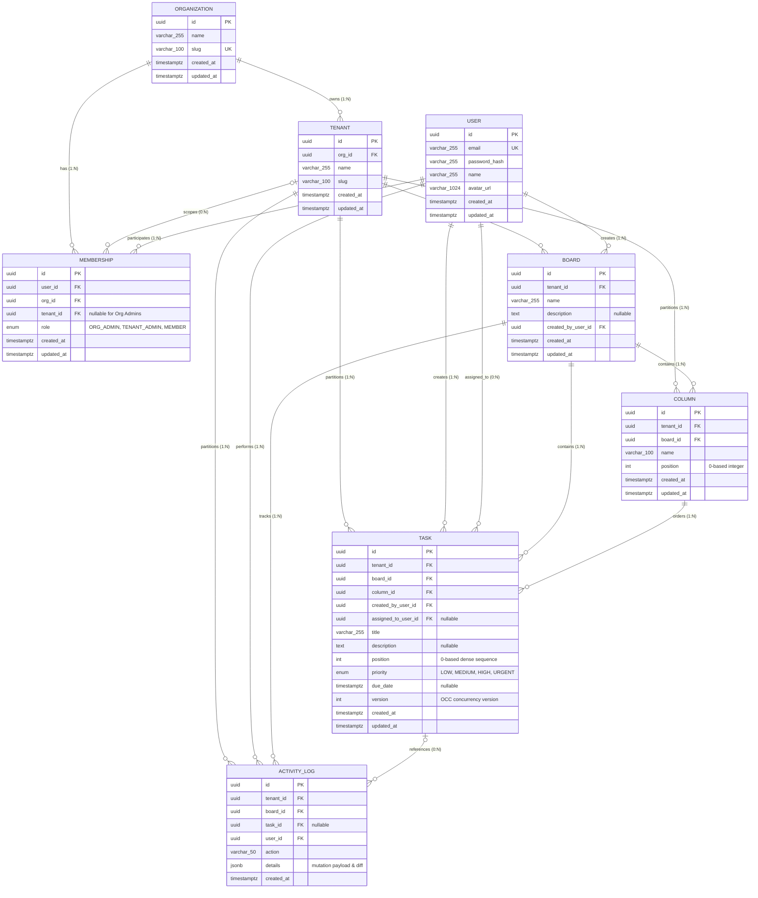

# JulleyOnline — Database Entity Relationship (ER) Diagram & Data Architecture Specification

## 1. Architectural Overview & Entity Hierarchy

JulleyOnline implements a strict multi-organization and multi-tenant data architecture built on PostgreSQL and Prisma ORM.

The core isolation boundaries follow a three-tier hierarchy:
1. **Organization Tier (`organizations`)**: Global top-level customer boundary. Administered by `ORG_ADMIN`.
2. **Tenant Tier (`tenants`)**: Partitioned workspaces within an organization. Each organization can have multiple isolated tenant workspaces. Administered by `TENANT_ADMIN` or `ORG_ADMIN`.
3. **Workspace Data Tier (`boards`, `columns`, `tasks`, `activity_logs`)**: Every board, column, task, and activity log is explicitly tied to a `tenant_id` to guarantee tenant data isolation at the database layer.

Cross-cutting entities:
- **`users`**: Global identity tier allowing a user to hold scoped memberships across multiple organizations and tenants.
- **`memberships`**: Scoped Role-Based Access Control (RBAC) mapping users to organizations (as `ORG_ADMIN`) or tenants (as `TENANT_ADMIN` or `MEMBER`).

---

## 2. Mermaid Entity-Relationship Diagram

---

## 3. Detailed Table Specifications & Constraints

### 3.1 `organizations`
Represents top-level tenant boundaries.
- **Primary Key**: `id` (`uuid`)
- **Unique Constraints**: `slug` (`varchar(100)`)
- **Relations**:
  - `tenants`: 1-to-many (`Tenant[]`, cascade delete)
  - `memberships`: 1-to-many (`Membership[]`, cascade delete)

### 3.2 `tenants`
Isolated workspaces belonging to a parent organization.
- **Primary Key**: `id` (`uuid`)
- **Foreign Keys**: `org_id` -> `organizations(id)` ON DELETE CASCADE
- **Unique Constraints**: `(org_id, slug)` (Slug uniqueness is scoped per organization)
- **Indexes**: `idx_tenants_org_slug` on `(org_id, slug)`
- **Relations**:
  - `organization`: belongs to `Organization`
  - `memberships`: 1-to-many (`Membership[]`, cascade delete)
  - `boards`: 1-to-many (`Board[]`, cascade delete)
  - `columns`: 1-to-many (`Column[]`, cascade delete)
  - `tasks`: 1-to-many (`Task[]`, cascade delete)
  - `activity_logs`: 1-to-many (`ActivityLog[]`, cascade delete)

### 3.3 `users`
Global authentication and identity principal.
- **Primary Key**: `id` (`uuid`)
- **Unique Constraints**: `email` (`varchar(255)`)
- **Relations**:
  - `memberships`: 1-to-many (`Membership[]`, cascade delete)
  - `createdBoards`: 1-to-many (`Board[]`, restrict delete)
  - `createdTasks`: 1-to-many (`Task[]`, restrict delete)
  - `assignedTasks`: 1-to-many (`Task[]`, set null on delete)
  - `activityLogs`: 1-to-many (`ActivityLog[]`, cascade delete)

### 3.4 `memberships`
Role-based permission scoping.
- **Primary Key**: `id` (`uuid`, generated via Prisma `@default(uuid())`)
- **Foreign Keys**:
  - `user_id` -> `users(id)` ON DELETE CASCADE
  - `org_id` -> `organizations(id)` ON DELETE CASCADE
  - `tenant_id` -> `tenants(id)` ON DELETE CASCADE (Nullable: `NULL` represents organization-wide administrator)
- **Unique Constraints**:
  - `UNIQUE (user_id, org_id, tenant_id)`
  - Partial Unique Index: `idx_unique_org_admin_membership` on `(user_id, org_id) WHERE tenant_id IS NULL` to prevent duplicate org-level memberships.
- **Indexes**:
  - `idx_memberships_user_tenant` on `(user_id, tenant_id)`
  - `idx_memberships_tenant_user` on `(tenant_id, user_id)`
- **Enum `Role`**:
  - `ORG_ADMIN`: Full administrative control across the entire organization and all subordinate tenants.
  - `TENANT_ADMIN`: Administrative control within assigned tenant workspaces.
  - `MEMBER`: Standard read and write permissions within assigned tenant workspaces.

### 3.5 `boards`
Kanban boards scoped strictly to a tenant workspace.
- **Primary Key**: `id` (`uuid`)
- **Foreign Keys**:
  - `tenant_id` -> `tenants(id)` ON DELETE CASCADE
  - `created_by_user_id` -> `users(id)` ON DELETE RESTRICT
- **Indexes**: `idx_boards_tenant_created` on `(tenant_id, created_at DESC)`
- **Relations**:
  - `columns`: 1-to-many (`Column[]`, cascade delete)
  - `tasks`: 1-to-many (`Task[]`, cascade delete)
  - `activityLogs`: 1-to-many (`ActivityLog[]`, cascade delete)

### 3.6 `columns`
Workflow stages/lanes within a Kanban board.
- **Primary Key**: `id` (`uuid`)
- **Foreign Keys**:
  - `tenant_id` -> `tenants(id)` ON DELETE CASCADE
  - `board_id` -> `boards(id)` ON DELETE CASCADE
- **Indexes**: `idx_columns_board_position` on `(board_id, position ASC)`
- **Ordering**: 0-based dense sequential integers (`position`).
- **Deletion Invariant**: Columns containing tasks cannot be deleted without first removing or moving all tasks (`400 Bad Request`).

### 3.7 `tasks`
Work items managed on the Kanban board.
- **Primary Key**: `id` (`uuid`)
- **Foreign Keys**:
  - `tenant_id` -> `tenants(id)` ON DELETE CASCADE
  - `board_id` -> `boards(id)` ON DELETE CASCADE
  - `column_id` -> `columns(id)` ON DELETE CASCADE
  - `created_by_user_id` -> `users(id)` ON DELETE RESTRICT
  - `assigned_to_user_id` -> `users(id)` ON DELETE SET NULL (Nullable)
- **Indexes**:
  - `idx_tasks_column_position` on `(column_id, position ASC)`
  - `idx_tasks_tenant_id` on `(tenant_id, id)`
- **Optimistic Concurrency Control (OCC)**:
  - `version` (`int`, default `1`): Increments monotonically on each mutation (task move, edit, priority change).
  - Mutations specifying an outdated version result in `HTTP 409 Conflict` with the latest authoritative server state payload.
- **Enum `Priority`**: `LOW`, `MEDIUM`, `HIGH`, `URGENT`

### 3.8 `activity_logs`
Immutable audit trail capturing all state mutations.
- **Primary Key**: `id` (`uuid`)
- **Foreign Keys**:
  - `tenant_id` -> `tenants(id)` ON DELETE CASCADE
  - `board_id` -> `boards(id)` ON DELETE CASCADE
  - `task_id` -> `tasks(id)` ON DELETE SET NULL (Nullable)
  - `user_id` -> `users(id)` ON DELETE CASCADE
- **Indexes**: `idx_activity_board_created` on `(board_id, created_at DESC)`
- **Payload**: `details` (`jsonb`) stores mutation delta, old and new positions, column changes, and collaborator metadata.

---

## 4. Multi-Tenant Isolation, Ordering & Safety Invariants

1. **Identifier & Timestamp Management**:
   UUID primary keys and timestamp updates are managed at the application layer via Prisma ORM (`@default(uuid())`, `@updatedAt`) rather than custom PostgreSQL trigger functions.
2. **Tenant Scoping Architecture**:
   Foreign keys preserve referential integrity across the data tier. Strict tenant data isolation is enforced through authenticated context validation in `tenant.middleware.js` and mandatory `where: { tenantId }` scoping on every operational database query.
3. **Safe Deletion Policy**:
   - `DELETE /api/v1/organizations/:id` and `DELETE /api/v1/tenants/:id` verify active resources (boards, tasks).
   - If subordinate resources exist, deletion is blocked with `HTTP 400 Bad Request` unless the caller explicitly passes `?force=true`.
4. **Optimistic Concurrency Control (OCC) & Deletion Safety**:
   - All task mutations and deletions enforce atomic version checks (`where: { id: taskId, tenantId, version }`).
   - If a collaborator modified the task in the interim, mutations and deletions abort with `HTTP 409 Conflict` and return the latest authoritative server state.
5. **Transactional Contiguous Ordering**:
   Task positions (`position: 0, 1, 2, ... N-1`) within each column are maintained contiguously inside transactions serialized under column row locks (`SELECT 1 FROM columns WHERE id = ... FOR UPDATE`). Position gaps are closed automatically upon deletion and reordering.
6. **Activity Log Lifecycle**:
   Activity logs track operations on boards and tasks. In line with PostgreSQL foreign key cascading rules, deleting an organization, tenant workspace, or user cascades to delete related activity records, and deleting a task sets `task_id` to `NULL` (`ON DELETE SET NULL`).